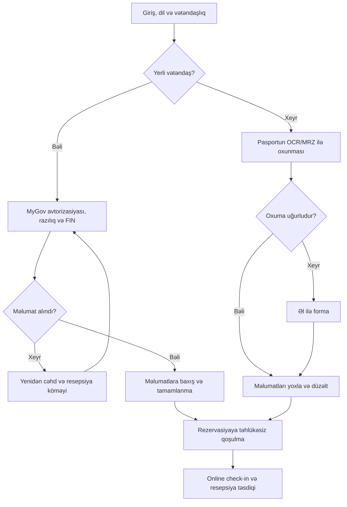
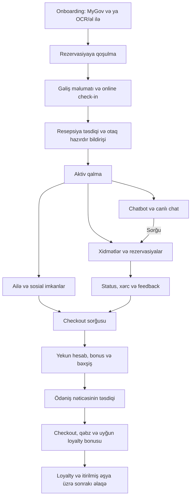
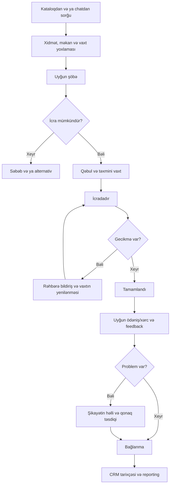
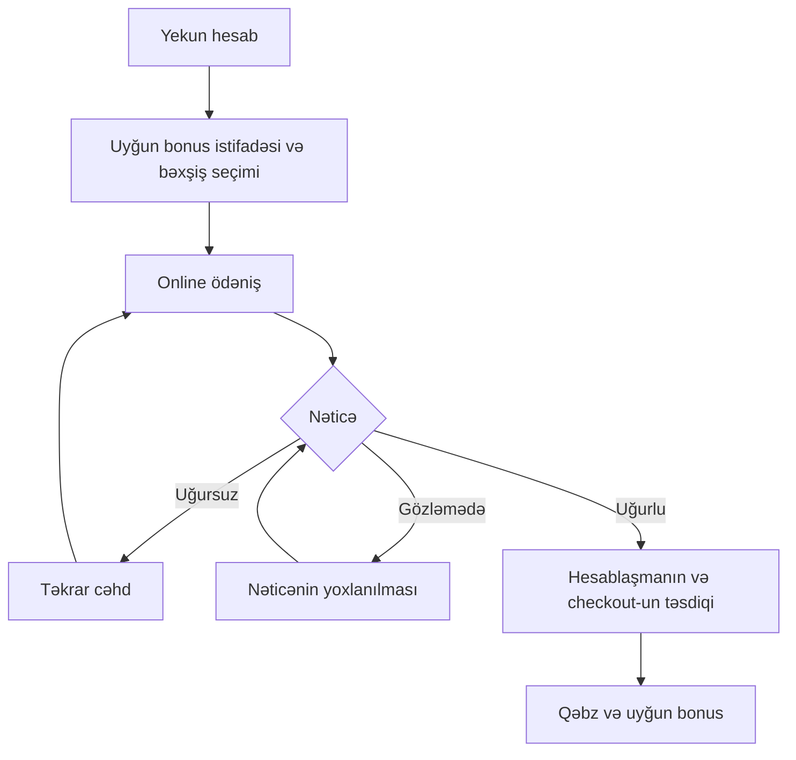

# Tabia Guest — interaktiv satış təqdimatı və MVP planı

Son yenilənmə: 20 oktyabr 2026

## 1. Bu sənədin məqsədi

Bu README otel mobil tətbiqi haqqında razılaşdırılmış məhsul tələblərini, MVP seçimini və məhsulu otelə təqdim etmək üçün hazırlanacaq interaktiv veb təqdimatın planını bir yerdə saxlayır. Layihə GitHub Copilot ilə VS Code daxilində davam etdiriləcək.

**Hazırda hazırlanacaq nəticə:** brauzerdə açılan satış təqdimatı, onun daxilində işləyən mobil/otel admin prototipləri və Supabase üzərində real PIN, müştəri rəyi və təqdimat analitikası.

**Brend:** şirkət Tabia, məhsulun işçi adı **Tabia Guest**. Verilmiş loqo şirkət loqosudur; ayrıca məhsul loqosu və son rəng/font sistemi hələ təsdiqlənməyib.

**Hazırkı vəziyyət:** Faza 0–9 tamamlanıb: React + JavaScript + Vite üzərində Tailwind v4, shadcn/ui (Radix, Nova preset, `tsx: false`), `@` alias, Motion, Zustand, React Router, qrcode.react və Prettier qurulub; Tabia rəng/font tokenləri, loqo komponentləri və favicon hazırdır. Ana səhifə (5 bölmə), `/:deckId/:slideId` slayd shell-i (tam/qısa tur, mövzu siyahısı, klaviatura, tam ekran), `PhoneFrame` və `HotelAdminFrame` işləyir. Faza 3: demo mühərriki (qrup üzrə ortaq store, ortaq action-larla autoplay, pauza/davam, reset, slayddan çıxanda timer təmizlənməsi, əl ilə toxunuşda autoplay-in dayanması, toxunuş göstəricisi), telefonun dark teması, AZ/EN/RU dil sistemi və animasiyalı telefon komponentləri hazırdır; Vitest testləri var. Faza 4: yemək sifarişi (slayd `food-order`) tam işləyir — menyu, kateqoriyalar, detal və seçimlər, səbət (geri qaytarma ilə), otaq/hovuz yeri və demo QR skanı, yoxlama, sifariş, status izləmə, otaq hesabına yazılma və rəy; restoran tərəfi slaydın sol sütununda “Restoran paneli” (otel panelinin sifariş kartı) ilə idarə olunur; Faza 9: slayd `hotel-admin`-də tam otel paneli (bax 9.1). Fotolar Unsplash License ilə `public/assets/demo/` daxilində lokal saxlanılır, mənbə ID-ləri `menuData.js`-dədir. Digər slaydlar hələ “Bu ssenari hazırlanır” placeholder-idir. Faza 5: Supabase backend (miqrasiya, RLS, PIN/rəy/analitika RPC-ləri, JS klienti, PGlite testləri) hazırdır, quraşdırma addımları 24.7-dədir. Faza 6: `/` və bütün slayd linkləri PIN girişindən keçir (PIN, sonra rəy görünürlüyü seçimi, çıxış, PIN ləğv/bitəndə avtomatik bağlanma); `/admin`-də Tabia hesabı ilə giriş PIN-siz “Admin önizləməsi” verir — bax 24.8. Faza 7: slayd altında Bəyəndim/Bəyənmədim, “Rəyləri göstər” paneli (şərh/təklif/sual, ad yaddaşı, görünürlüyü dəyişmə) və baxış/aktiv vaxt izləməsi işləyir — bax 24.9. Faza 8: `/admin` Developer Team paneli (İcmal, Rəylər və cavablar, PIN-lər, Slaydlar) və admin önizləməsində rəylər/cavablar — bax 24.10. Faza 10 (slaydlar ardıcıl, istifadəçi təsdiqi ilə): telefonda 15 dil (4-ü RTL), işıqlı (standart) və qaranlıq tema, tətbiqdaxili Tənzimləmələr (dişli düymə) və bütün slaydlar üçün ortaq, brauzerdə saxlanan seçim hazırdır — bax 5.4; MVP-də slayd 1-dən əvvəl nömrəsiz `intro` giriş səhifəsi və slayd 1 (`overview`, qonaq ana səhifəsi və tablar) hazırdır. Növbəti slaydlar istifadəçi deyəndən sonra hazırlanır. TypeScript-ə keçid planlaşdırılmır. Supabase və digər paketlər öz fazalarında əlavə olunacaq. Bu sənəd planı göstərir, funksiyaların hazır olması iddiası deyil.

**Gələcək məhsul:** qonağın otelə gəlişindən əvvəlki hazırlığından checkout və sonrakı əlaqəyə qədər xidmətləri idarə etdiyi mobil tətbiq, əməkdaşlar üçün admin paneli, CRM və reporting.

Təqdimat prototipi ilə istehsal üçün hazır məhsulu ayır:

- Otel prototipinin məlumatları, xidmət əməliyyatları və inteqrasiyaları lokal demo məlumatları ilə işləyəcək.
- Təqdimatın PIN girişi, müştəri rəyləri və baxış analitikası real Supabase məlumatlarıdır; otel demo store-u ilə qarışdırılmır (bölmə 24).
- MyGov, OCR, canlı video, bank ödənişi və Opera PMS-ə həqiqi bağlantı ilk təqdimatın şərti deyil.
- Simulyasiya olunan inteqrasiyaları istifadəçiyə aydın şəkildə “Demo” kimi göstər.
- Aşağıda təsvir edilən imkanlar tələblərdir. Bu sənəd onların artıq implementasiya edildiyi mənasına gəlmir.

## 2. Qərarlar və açıq məsələlər

| Mövzu | Status | Qərar / qeyd |
| --- | --- | --- |
| Məhsulun istiqaməti | Razılaşdırılıb | Qonaq tətbiqi və onu idarə edən admin paneli |
| Mobil MVP modulları | Razılaşdırılıb | Onboarding, Reservation, Hotel Services, Loyalty, Chatbot |
| Admin paneli | Razılaşdırılıb | Mobil funksiyaların idarəsi, ayrıca CRM və Reporting |
| MVP siyahısı | İstifadəçi seçib | İlkin 95 maddədən 65-i MVP kimi işarələnib |
| Yerli vətəndaş | Razılaşdırılıb | MyGov vasitəsilə, FIN əsasında məlumatların alınması planlaşdırılır |
| Xarici vətəndaş | Razılaşdırılıb | Pasportun OCR/MRZ ilə oxunması və əl ilə doldurma alternativi |
| Təqdimat formatı | Razılaşdırılıb | Slayd kimi dəyişən veb səhifə və yan tərəfdə interaktiv iPhone prototipi |
| Ana menyu | Razılaşdırılıb | PIN girişindən sonra 5 kart: MVP/Demo, İcra planı və İnteqrasiya, Əlavə Təkliflər, Portfoliomuz, Qiymətlər |
| Təqdimat girişi | Razılaşdırılıb | Adminin yaratdığı 4 rəqəmli PIN; müştəriyə email/parol tələb olunmur |
| Müştəri rəyləri | Razılaşdırılıb | Slayd üzrə bəyənmə, şərh, təklif, sual və funksiya prioriteti; public və ya yalnız vendor görünürlüyü |
| Rollar | Razılaşdırılıb | Təqdimatı hazırlayan və `/admin`-i idarə edən tərəf **Developer Team**-dir (vendor). Tabia qrupu müştəridir: PIN-lər Tabia nümayəndələrinə verilir, onlar təklifə baxıb rəy yazır. UI-da vendor tərəf “Developer Team”, public rəyi görənlər “Tabia komandasının nümayəndələri” adlanır. Bu sənəddə köhnə “Tabia admini / Tabia idarə paneli” ifadələri Developer Team panelini bildirir |
| Tabia idarə paneli | Razılaşdırılıb | /admin (Developer Team paneli): Supabase email/parol, icazəli adminlər, PIN-lər, rəylər və baxış statistikası |
| Təqdimat yolları | Razılaşdırılıb | Tam tur və qısa tur; qısa turun ilkin tərkibi bölmə 14-də təklif olunur |
| Texniki istiqamət | JavaScript seçimi razılaşdırılıb; qalanı icra planı | React, JavaScript, Vite, Tailwind CSS, shadcn/ui, Motion, Zustand, React Router; təqdimat datası üçün Supabase |
| İlk hazırlanacaq demo | Tövsiyə | Tam işlək yemək sifarişi ssenarisi |
| Brend, loqo və məhsul adı | Qismən razılaşdırılıb | Şirkət Tabia, verilmiş şirkət loqosu, işçi ad Tabia Guest; Faza 1 dizayn sistemi ilkin təklifdir (5.2), istifadəçi rəyi ilə dəyişə bilər |
| Qiymət və paket məbləğləri | Açıqdır | Rəqəmləri uydurma. Lazım olduqda “Razılaşdırılacaq” göstər |
| Komanda və portfolio məlumatları | Açıqdır | Yalnız verilmiş real məlumatlardan istifadə et |
| Konkret otel və avadanlıq | Açıqdır | Otelin adı, PMS versiyası, POS, kameralar və digər sistemlər dəqiqləşəcək |
| OCR təchizatçısı | Açıqdır | Hazır həll seçimi, lisenziya, sənəd dəstəyi və işləmə mühiti araşdırılacaq |
| İnterfeys dili | Razılaşdırılıb | Təqdimat çərçivəsi Azərbaycan dilində. Telefondakı qonaq tətbiqi çoxdillidir (5.4) |
| Telefondakı tətbiqin UI/UX-i | Razılaşdırılıb | Tabia Guest brendi, dark mode, müasir super-app sıxlığı, zəngin animasiya, lisenziyalı lokal stok foto (5.4) |

Sonrakı istifadəçi düzəlişləri bu sənəddəki tövsiyələrdən üstündür. Bir tövsiyəni səssiz şəkildə təsdiqlənmiş biznes qərarına çevirmə.

## 3. Məhsulun məqsədi və auditoriya

Qonaq resepsiyaya getmədən və təkrar zəng etmədən ehtiyacını tətbiqdən bildirir, sifarişin gedişini izləyir, rezervasiya edir və hesablaşır. Otel əməkdaşı həmin müraciəti admin panelində qəbul edir və nəticəsini qonağa çatdırır.

Satış təqdimatının əsas auditoriyası otel sahibi, baş menecer, əməliyyat rəhbəri, resepsiya, restoran/spa rəhbərləri və IT komandasıdır.

Təqdimat aşağıdakı sualları cavablandırmalıdır:

1. Otel hansı məhsulu alır?
2. Qonaq və əməkdaş necə istifadə edir?
3. Hansı əməliyyat problemi həll olunur?
4. Mövcud otel sistemlərinə necə qoşulur?
5. Pilot və istifadəyə keçid necə təşkil olunur?
6. Qiymətə nə daxildir və sonrakı dəstəyi kim verir?

“Gəlir 30% artacaq” kimi təsdiqlənməmiş nəticələrdən istifadə etmə. Faydanı konkret ssenari ilə izah et: qonaq dəsmal sifariş edir, müraciət housekeeping-ə çatır, resepsiyanın əlavə zənginə ehtiyac azalır.

## 4. Ana səhifə və satış bölmələri

Son razılaşmaya görə `/` ünvanında əvvəl PIN girişi, sonra 5 kart/düymədən ibarət ana səhifə açılır. Slayd avtomatik başlamır: **MVP/Demo** kartına klikləyəndə slayd axını başlayır. İlk hazırlanacaq bölmə MVP/Demo-dur; hazır olmayan bölmələr açıq şəkildə “Hazırlanır” göstərilir.

| Bölmə | Məzmun |
| --- | --- |
| MVP/Demo | Funksiyalar və faydalar, iPhone ssenariləri, otel admin demosu, CRM və reporting |
| İcra planı və İnteqrasiya | Opera PMS, POS, ödəniş, MyGov, OCR, kamera; oteldən tələb olunanlar; pilot, təlim və istifadəyə keçid |
| Əlavə Təkliflər | Əlavə A-dakı MVP-yə seçilməyən 30 funksiya və Əlavə C ideyaları; “Vacibdir / Lazım deyil” səsverməsi |
| Portfoliomuz | Əvvəlki real işlər və açıq etiketlənmiş demo nümunələri |
| Qiymətlər | Qurulum, aylıq xidmət, modullar, əlavə inteqrasiyalar, dəstək və provayder xərcləri |

Komanda və Faydalar ayrıca ana menyu kartları deyil. Fayda məhsul ssenarilərində, təsdiqlənmiş komanda/dəstək məlumatları isə uyğun satış məzmununda verilə bilər. Əlavə təklifə səs verilməsi onu avtomatik MVP-yə daxil etmir.

Tövsiyə edilən əlavə elementlər:

- Əsas çağırış: “Demo görüşü təyin et” və ya “Pilot üçün müraciət et”. Həqiqi göndəriş sistemi yoxdursa uğurlu göndərişi saxtalaşdırma.
- Tətbiq planında pilotun çərçivəsi və ölçüləcək göstəricilər.
- Təhlükəsizlik və məlumatlara giriş mövzusunun qısa izahı.
- Sonda FAQ: təlim, avadanlıq, inteqrasiyalar, sistem kəsintisi, dəstək.
- Məhsuldan geri ana səhifəyə qayıtmaq üçün aydın naviqasiya.

## 5. Təqdimatın formatı və görünüşü

### 5.1. Ümumi kompozisiya

- Giriş icazəsi təsdiqləndikdən sonra ana seçim səhifəsi görünür; birbaşa slayd linki də eyni giriş yoxlamasından keçir.
- Məhsul/MVP bölməsinə keçəndə slayd rejimi başlayır.
- Desktop-da solda mövzu və qısa izah, sağda iPhone çərçivəsində interaktiv prototip olur.
- Hər slayd qonağın bir işi və ya bir-biri ilə bağlı əməliyyat ssenarisini izah edir.
- Eyni iPhone çərçivəsi təkrar istifadə olunur, daxilindəki ekran və vəziyyət dəyişir.
- Telefonda düymələr, formalar, seçimlər, sifariş və status keçidləri işləyir.
- Admin slaydlarında desktop admin görüntüsü daha geniş yer tutur. iPhone həmin əməliyyatın qonaq tərəfini göstərir.
- CRM və reporting slaydlarında mobil hissə aidiyyəti qonaq profilini və ya əməliyyatı göstərir. Əsas izah desktop panelindədir.

### 5.2. Vizual istiqamət

- Otel satış təqdimatına uyğun səliqəli, müasir və oxunaqlı görünüş.
- Böyük başlıqlar, qısa mətnlər və geniş boşluqlar.
- Hər ekranı çoxlu kart və panel ilə doldurma.
- Əvvəlki PPT-dəki tünd petrol/teal, açıq krem və mint tonları başlanğıc istiqaməti idi, məcburi brend deyil.
- Faza 1 ilkin dizayn sistemi (`src/index.css`): petrol `#0f3d3e`, ink `#13272a`, soyuq açıq fon mist `#eef3f1`, mint `#a8dcc7`, xəta üçün pomegranate `#b3403a`. Başlıqlar Unbounded (TABIA yazısının geniş həndəsi formasına uyğun), mətn Geist; hər ikisində Ə/ə daxil Azərbaycan hərfləri yoxlanıb. Yadda qalan element loqo ornamentidir; digər elementlər sakit saxlanılır.
- Loqo `TabiaLogo`, ornament `TabiaMark` komponentləri ilə `currentColor` rəngində istifadə olunur; favicon ornamentdən hazırlanıb.
- Slaydlar arasında vahid font, spacing və komponent sistemi.
- iPhone çərçivəsində status sətri və aşağı təhlükəsiz sahə üçün yer.
- Hərəkətlər funksiyanı izah etsin: səhifə keçidi, səbətə əlavə, təsdiq, status yenilənməsi.
- Təqdimat çərçivəsi sakit qalır; zəngin animasiya telefondakı tətbiqdədir (5.4). Uzun gözləmələrdən qaç.
- Azərbaycan hərflərini və uzun mətnləri düzgün göstər.
- Tam ekran təqdimatında 16:9 kompozisiyasını nəzərə al, müxtəlif desktop ölçülərində kəsilmə olmasın.
- Mobil brauzerdə mətn və prototip şaquli düzülə bilər, vacib düymələr itməməlidir.

### 5.3. Təqdimat idarələri

- Əvvəlki/növbəti slayd.
- Slayd nömrəsi və mövzu siyahısı.
- Ana səhifəyə qayıt.
- Tam ekran rejimi və tam ekrandan çıxış.
- Slaydın demosunu yenidən başlat.
- “Demoya bax”, “Pauza” və lazım olduqda “Davam et”.
- Klaviatura ilə naviqasiya, amma input/select/textarea və telefon daxilində yazışma zamanı slayd dəyişməsin.
- Hər slaydda bəyənmə, rəy yazma və funksiya prioriteti üçün yer ayrılır; bunlar telefon demosundan kənardadır.
- “Rəyləri göstər” düyməsi həm müştəri, həm təqdimat rejimində paneli açıb-bağlayır. Rəy formasında yazarkən slayd klaviatura qısayolları işə düşmür.
- `?mode=present` yalnız görünüş rejimidir, giriş icazəsi vermir. Təklif: bu rejimdə rəy paneli bağlı başlasın.

### 5.4. Telefondakı qonaq tətbiqinin UI/UX-i

İstifadəçi qərarı: demo UI/UX yüksək səviyyədə olsun; sadə, amma “cool”. Bu bölmə telefondakı Tabia Guest tətbiqinə aiddir, təqdimat çərçivəsinə yox.

| Mövzu | Qərar |
| --- | --- |
| Brend | Telefonda **Tabia Guest** brendi (white-label deyil) |
| Tema | **İşıqlı (standart) və qaranlıq** rejim; qonaq tətbiqdaxili Tənzimləmələrdən dəyişir. İşıqlıda açıq mint-boz fon, ağ kartlar, dərin petrol vurğu; qaranlıqda petrol-qara fon və parlaq mint vurğu. Status rəngləri hər iki temada kontrastlı |
| Sıxlıq | Müasir super-app: kartlar, sürətli əməliyyat düymələri, üfüqi karusellər, aktiv sifariş izləyicisi, aşağı tab bar |
| Dil | 15 dil: AZ (standart), EN, RU, TR, FA, KA, KK, HE, UR, UZ, ZH, HI, AR, DE, FR (Azərbaycana gələn əsas turist bazarları üzrə). FA, HE, UR, AR sağdan sola (RTL) göstərilir. Çatışmayan tərcümə əvvəl EN-ə, sonra AZ-a düşür. Bütün UI mətnləri və demo məlumatları (menyu adları və s.) lüğətdən gəlir. Tərcümələr demo üçündür, dil daşıyıcısı tərəfindən yoxlanmalıdır |
| Tənzimləmələr | Hər slayddakı telefonda dişli düyməsi və Profil tabı Tənzimləmələr sheet-ini açır: Görünüş (İşıqlı/Qaranlıq) və Dil. Seçim qlobaldır (bir slaydda dəyişən hamısında dəyişir), brauzerdə saxlanır və demo reset-dən asılı deyil. Onboarding slaydında (2) qonaq dili giriş zamanı özü seçəcək |
| Animasiya | Bol və canlı, amma hər biri hərəkətə və ya state dəyişikliyinə bağlı: ekran keçidləri, kartdan detala paylaşılan element keçidi, spring bottom sheet (sürüşdürüb bağlama), səbətə uçan məhsul və sayğac sıçrayışı, toxunuşda sıxılma effekti, status xəttinin dolması, siyahıların ardıcıl girişi, rəqəm dəyişmə animasiyası |
| Şəkillər | Lisenziyası açıq stok foto (məs. Unsplash), `public/assets/demo/` daxilində lokal və optimallaşdırılmış saxlanılır; mənbə siyahısı saxlanılır. Real uşaq və tanınan şəxs fotosu istifadə edilmir. İstisna: qonağın otaq şəkli (`shamakhi-palace-room.jpg`) və `public/assets/demo/shamakhi/` daxilindəki restoran, spa/fitnes və əyləncə şəkilləri istifadəçinin göstərişi ilə müştərinin Shamakhi Palace saytından götürülüb |
| Demo qonaq | Ramilə, SHAMAKHI PALACE SHARADIL (Şamaxı rayonu), otaq 412, Grand Deluxe King. Otel və otaq növü adları tərcümə olunmur |
| Otel konteksti | Tətbiq yalnız qonağın rezervasiyası olan otelin məlumatlarını göstərir (xidmətlər, restoranlar, əyləncə, proqram, bildirişlər) |
| İstinad | Awwwards “Mobile & Apps” kolleksiyasındakı müasir dark, cəsarətli tipoqrafiyalı və hərəkətli tətbiq dizaynları ruhunda; konkret dizayn kopyalanmır |

UX qaydaları:

- Hər ekranda bir əsas hərəkət; əsas düymələr baş barmaq zonasında, toxunuş sahəsi ən azı 44px.
- Hər əməliyyatın nəticəsi dərhal görünür: təsdiq, status, səbət sayı. Silinən səbət elementi üçün geri qaytarma.
- Yüklənmə üçün qısa skeleton; uzun spinner yox. Demo gecikmələri təqdimatı yavaşlatmayacaq qədər qısa.
- Boş və xəta vəziyyətləri növbəti addımı göstərir.
- Animasiyalar qısa (təxminən 150–400 ms), autoplay ilə deterministik; reduced-motion rejimində yalnız sadə keçid qalır.
- Mətn və ikon kontrastı hər iki temada WCAG AA-ya uyğun; fokus görünür; dil dəyişəndə uzun Azərbaycan/rus sözləri kəsilmir; RTL dillərdə istiqamət, oxlar və ekran keçidləri güzgülənir.

## 6. Demo davranışı və state qaydaları

### 6.1. İki rejim

**Əl ilə istifadə:** təqdim edən şəxs iPhone daxilində klikləyir və formaları doldurur.

**Avtomatik demo:** “Demoya bax” eyni ssenarini addım-addım oynadır.

Hər iki rejim eyni state keçidlərini və əməliyyat funksiyalarını istifadə etməlidir. Autoplay üçün UI-dan ayrı, ziddiyyətli biznes məntiqi qurma.

### 6.2. Hər ssenarinin müqaviləsi

Hər demo üçün bunları müəyyənləşdir:

1. İlkin ekran və məlumatlar.
2. İstifadəçinin edə biləcəyi hərəkətlər.
3. Hərəkətdən sonrakı state və vizual nəticə.
4. Lazım olan gözləmə, uğurlu və uğursuz vəziyyətlər.
5. Eyni ssenarinin autoplay addımları.
6. Reset və slayddan çıxış davranışı.

### 6.3. Texniki qaydalar

- İlk girişdə hər slayd müəyyən edilmiş ilkin demo vəziyyətindən başlayır.
- Slayddan çıxanda taymerlər, avtomatik addımlar və dinləyicilər dayandırılır.
- Reset həmişə eyni ilkin vəziyyəti qaytarır.
- Əlaqəli qonaq/admin səhnələri ortaq demo store-dan istifadə edir.
- Store-un ömrü ssenari qrupuna uyğun qurulur: əlaqəli səhnələrin ortaq məlumatını kor-koranə hər slayd keçidində silmə. İlk giriş/reset deterministikdir; remount timer cleanup-ını əvəz etmir.
- Ayrı demo ssenarilərinin məlumatları təsadüfən bir-birinə qarışmır.
- Eyni sifariş iki dəfə yaranmır. Autoplay və əl ilə klik ziddiyyətində təyin edilmiş davranış olsun, məsələn əl ilə toxunuş autoplay-i pauza etsin.
- Otel demo ssenariləri real məlumat və xarici API olmadan işləsin. Təqdimatın real giriş/rəy/analitika hissəsi Supabase-dən asılıdır; şəbəkə xətası demo state-ini pozmamalıdır və giriş yoxlamasını keçməməlidir.
- Saxta ad, rezervasiya və sənəd məlumatlarını demo kimi göstər. Həqiqi FIN/pasport və uşaqların real videosundan istifadə etmə.
- Qurğu kamerasının həqiqi icazəsi təqdimat demosu üçün tələb olunmasın. “Kamera” ekranı nümunə görüntü ilə simulyasiya oluna bilər.
- Kart məlumatları toplama. Ödənişi açıq şəkildə demo ekranı ilə göstər.
- Müştəri tərəfdə məxfi açar saxlama.

## 7. Mobil MVP modul xəritəsi

| Modul | Əhatə dairəsi |
| --- | --- |
| Onboarding | Hesab, giriş, dil, vətəndaşlıq, yerli MyGov/FIN, xarici OCR/MRZ, əl ilə alternativ, rezervasiyaya qoşulma |
| Reservation | Rezervasiyanın hesaba əlavə edilməsi, gəliş/çıxış, online check-in/out, erkən/gec giriş-çıxış, uzatma, otaq dəyişikliyi və upgrade, yekun hesab və qəbz |
| Hotel Services | Yemək, restoran/spa, təmizlik və otaq xidmətləri, nəqliyyat, proqram, paket şərtləri, ailə/sosial, canlı video, feedback, itirilmiş əşya, xərclər və ödəniş |
| Loyalty | Hesab, bonus qazanılması/istifadəsi, fərdi təkliflər |
| Chatbot | Otel üzrə AI sual-cavab, tərcüməli canlı chat, əməkdaşa keçid, chatdan xidmət sorğusu |

Otaq rezervasiyası Reservation modulundadır. Restoran/spa rezervasiyası Hotel Services daxilindədir. Checkout Reservation-a aiddir, xərc və ödəniş komponentləri ilə ortaq işləyir.

Yeni otaq rezervasiyasının axtarış və satış mühərriki ayrıca təsdiqlənməyib. MVP-də dəqiq tələb mövcud rezervasiyanın tətbiqə əlavə edilməsi və idarəsidir. Təsdiqlənməmiş tam booking engine yaratma.

## 8. Onboarding ssenariləri

### 8.1. Ortaq başlanğıc

1. Dil seçimi.
2. Telefon və ya e-poçt vasitəsilə giriş/qeydiyyat və birdəfəlik kod — təklif olunan baza axını.
3. Yerli və ya xarici vətəndaş seçimi.
4. Uyğun şəxsi məlumat axını.
5. Məlumatlara baxış və təsdiq.
6. Rezervasiya kodu və uyğunluq yoxlaması ilə hesaba bağlanma.
7. Online check-in məlumatlarının göndərilməsi.
8. Resepsiyanın yoxlaması və təsdiqi.

Tək rezervasiya nömrəsi və ya FIN bilmək başqa şəxsin profilinə giriş verməməlidir. İstehsal versiyasında qonaq-rezervasiya uyğunluğunu ayrıca təsdiqlə.

### 8.2. Yerli vətəndaş

- Plan: MyGov-dan FIN əsasında məlumat əldə etmək.
- Müvafiq avtorizasiya və razılıq addımı göstərilir.
- Gələn məlumatlar qonağa göstərilir, çatışmayan əlaqə məlumatları tamamlanır.
- Giriş/alınma uğursuzdursa yenidən cəhd və resepsiyanın köməyi təklif olunur.
- MyGov API, mövcud sahələr, avtorizasiya və tərəfdaşlıq şərtləri hələ təsdiqlənməyib. Yalnız FIN yazmaqla istənilən şəxsin məlumatını almağın mümkün olduğunu iddia etmə.

### 8.3. Xarici vətəndaş

- Qonaq pasportun məlumat səhifəsini kameraya göstərir.
- OCR və MRZ məlumatları çıxarıb formaya doldurur.
- Hədəf sahələr: ad, soyad, doğum tarixi, vətəndaşlıq, pasport nömrəsi, verən ölkə və etibarlılıq tarixi.
- Oxunmayan/olmayan sahələr əl ilə tamamlanır. Faktiki çıxarılan sahələr seçilən SDK və sənədə bağlıdır.
- Qonaq məlumatları yoxlayır, düzəldir və təsdiqləyir.
- Kamera/skan uğursuz olduqda və ya sənəd dəstəklənmədikdə bütün formanı əl ilə doldura bilir.
- Resepsiya sənədi ayrıca yoxlayır.
- OCR məlumat çıxarılmasıdır, özlüyündə sənədin həqiqiliyinin və şəxsin kimliyinin tam yoxlanması deyil.
- Microblink BlinkID mümkün həll nümunəsidir, təchizatçı seçimi deyil.

### 8.4. Admin və CRM-də onboarding

- Yerli/xarici qonaq filtri.
- Məlumat mənbəyi: MyGov, OCR/MRZ, əl ilə.
- Yoxlama statusu: gözləmədə, düzəliş tələb olunur, təsdiqləndi.
- Resepsiyanın yoxlama qeydi və vaxtı.
- Həssas məlumatların yalnız uyğun rola görünməsi.

## 9. Otel admin paneli — məhsul demosu

Bu bölmə slaydların daxilində göstərilən otel əməliyyat panelidir. `/admin` ünvanındakı **Tabia idarə paneli** isə real təqdimat rəylərini, PIN-ləri və baxışları idarə edir (bölmə 24). Otel xidmətinə demo feedback ilə təqdimat slaydına müştəri rəyi ayrı məlumatlardır.

| Bölmə | MVP funksiyaları |
| --- | --- |
| Hesab və onboarding | Qonaq profilləri, yerli/xarici, məlumat mənbəyi, yoxlama qeydləri və statusu |
| Reservation | Rezervasiya və dəyişiklik sorğuları, otaq təyinatı, gəliş/çıxış, check-in/out, otaq hazırdır bildirişi |
| Xidmət kataloqu | Xidmət, menyu, qiymət, iş saatı, paketə daxilolma, QR çatdırılma məkanları, günün proqramı |
| Xidmət əməliyyatları | Sorğunun qəbulu/rəddi, şöbəyə yönləndirmə, icra statusu, təxmini vaxt, gecikmə və rəhbərə bildiriş |
| Restoran/spa | Mövcud vaxtlar, tutum və təsdiq mexanizmi |
| Chatbot/chat | Bilik bazası, dillər, chat siyahısı, əməkdaşın söhbəti qəbul etməsi, chatdan sorğu |
| Ailə və sosial | Qrup idarəsi, şikayət və bağlama, canlı video üçün valideyn icazələrinin verilməsi/ləğvi |
| Loyalty | Bonus qaydaları, əməliyyatlar, səbəbli düzəlişlər, kampaniya və endirimlər |
| Hesab/ödəniş | Otaq xərcləri, online ödəniş statusları, bəxşiş, qəbz, uzlaşdırma |
| Feedback | Reytinq, şikayətin araşdırılması, həll statusu və qonaq təsdiqi |
| İtirilmiş əşya | Müraciətlər və checkout-dan sonrakı izləmə |
| Səlahiyyətlər | Administrator, resepsiya, şöbə əməkdaşı, menecer |

İlkin siyahıdakı 89 və 90 ayrıca MVP kimi işarələnməyib. Bununla belə, seçilmiş 16 və 19-un işləməsi üçün minimum şöbə yönləndirməsi, məsuliyyət və gecikmə idarəsi lazımdır. Tam tapşırıq/növbə idarəetmə sistemi əlavə scope kimi təsdiqlənməlidir.

### 9.1. Hazır demo: xidmət sorğuları (Faza 9)

- Kod: [src/modules/hotel-admin/orders](src/modules/hotel-admin/orders). Slayd `hotel-admin` (16): solda otel paneli (“Xidmət sorğuları”, Restoran şöbəsi; Yeni / İcrada / Bağlanıb sütunları), sağda qonaq telefonu. Slayd `food-order` (7) eyni sifariş kartını “Restoran paneli” kimi göstərir.
- Hər iki slayd `service-orders` store-unu paylaşır: slayd 7-də verilmiş sifariş slayd 16-da görünür, paneldə status dəyişəndə telefon dərhal yenilənir.
- Paneldə: təxmini vaxt seçərək qəbul (15/25/40 dəq), səbəblə rədd (məhsul yoxdur, mətbəx bağlıdır, bu yerə çatdırılmır), icraya başlama, gecikmə (+10 dəq, qonağa yeni vaxt göstərilir), çatdırıldı (yalnız telefondakı qonağın hesabına yazılır). Statuslar yalnız irəli gedir; rədd edilən sifarişə heç nə yazılmır və qonaq səbəbi öz dilində görür.
- Növbəni canlı göstərmək üçün başqa otaqların 3 demo sifarişi (#1039–#1041) var; onlar qonağın hesabına təsir etmir. Autoplay: telefonda qısa pizza sifarişi, sonra paneldə qəbul, icra, gecikmə və çatdırılma (toxunuş göstəricisi panel düymələrində də görünür).
- Panel dar ekranda sütunları alt-alta, geniş ekranda (konteyner ≥ 42rem) yan-yana göstərir. Şöbə yönləndirməsi, rehbərə bildiriş və digər bölmələr (onboarding, rezervasiya, chat və s.) Faza 10-da öz slaydları ilə əlavə olunacaq.

## 10. CRM

Vahid qonaq kartında:

- Profil, əlaqə, dil və vətəndaşlıq.
- MyGov/OCR/əl ilə məlumat mənbəyi və yoxlama statusu.
- Rezervasiya və qalma tarixçəsi.
- Xidmət sifarişləri və xərclər.
- Chat və şikayət tarixçəsi.
- Feedback və reytinqlər.
- İtirilmiş əşya müraciətləri.
- Loyalty balansı və bonus əməliyyatları.
- Əməkdaş qeydləri və sadə etiketlər: yeni, təkrar, VIP.

Eyni məlumat modullar arasında əlaqə ilə toplanır, təkrar daxil edilməməlidir. Demo üçün eyni qonaq və rezervasiya ID-si bütün uyğun səhnələrdə istifadə olunur.

## 11. Reporting

MVP hesabatları:

1. Rezervasiya sayı və status bölgüsü.
2. Check-in/out sayı.
3. Xidmət üzrə sifariş sayı və satış məbləği.
4. Ödəniş statusları və bəxşiş məbləği.
5. Açıq və gecikmiş müraciətlər.
6. İlk əməkdaş cavabına qədər müddət və sorğunun icra müddəti.
7. Qonaq reytinqi və şikayətlərin həll nəticəsi.
8. Verilmiş və istifadə edilmiş bonuslar.
9. Tarix, şöbə/xidmət və status filtrləri.
10. Excel/CSV ixracı.

Hesabat rəqəmlərini demo məlumatlarından hesabla. Göstəricinin dövrünü və status əsasını qeyd et. Sifariş məbləğini faktiki toplanmış ödənişlə qarışdırma. Demo göstəricilərini real biznes nəticəsi kimi göstərmə.

## 12. Əsas proseslər

### 12.1. Qonağın ümumi axını

### 12.2. Xidmət sifarişi

### 12.3. Chatbot

- Bilik bazasından otel haqqında cavab verir.
- Məlumat yoxdursa cavab uydurmur, əməkdaşa ötürür.
- Qonaq öz dilində, əməkdaş öz dilində yaza bilir.
- Tərcümə ilə yanaşı orijinal mətnə baxış var.
- Chatdan sorğu yarananda xidmət modulundakı eyni icra axını işləyir.
- Rezervasiya, ödəniş və icra nəticəsini mənbə sistem və ya əməkdaş təsdiqləyir.
- Demo AI cavabları əvvəlcədən hazırlanmış ssenari ilə işləyə bilər.

### 12.4. Checkout və ödəniş

- Artıq ödənilmiş xərci yenidən ödətdirmə. Ödənilməmiş qalıq ayrıca görünsün.
- Hesab sıfırdırsa bank ödənişi olmadan uyğun təsdiq axını işləsin.
- Bonus istifadəsi, bəxşiş və yekun məbləğ aydın göstərilsin.
- İstehsal versiyasında server provayder nəticəsini yoxlamalıdır. Təkrar callback ikinci əməliyyat və ya bonus yaratmamalıdır.
- Depozit/bloklanmış məbləğ 74-cü maddədir və hazırkı MVP seçiminə daxil deyil.

### 12.5. Tövsiyə edilən statuslar

| Obyekt | Statuslar |
| --- | --- |
| Qonaq yoxlaması | Gözləmədə, düzəliş tələb olunur, təsdiqləndi |
| Rezervasiya/qalma | Təsdiqlənmiş rezervasiya, check-in gözlənilir, otaq hazırdır, check-in edildi, checkout gözlənilir, checkout edildi |
| Xidmət | Yeni, qəbul edildi, icradadır, tamamlandı, rədd edildi |
| Chat | Bot, əməkdaş gözlənilir, əməkdaşla aktiv, bağlandı |
| Ödəniş | Gözləmədə, uğurlu, uğursuz |
| Şikayət | Yeni, araşdırılır, həll təklif edildi, qonaq təsdiqlədi, bağlandı |

Statuslar ilkin modeldir, son biznes qaydalarına uyğun dəqiqləşdiriləcək.

## 13. Ailə, sosial qruplar və uşaqların videosu

- Ailə/səyahət qrupu ilə digər qonaqların fəaliyyət qrupunu ayrı saxla.
- MVP-də fəaliyyət qrupu yaratmaq və qoşulmaq var.
- Xüsusi oyunçu tapma mühərriki, səviyyə/dil filtrləri və qrup chatı 62–64-cü maddələrdir, ayrıca MVP kimi seçilməyib.
- Sosial iştirak könüllüdür. Otaq nömrəsini və şəxsi əlaqə məlumatlarını digər qonaqlara avtomatik göstərmə.
- Qrup şikayəti və admin müdaxiləsi üçün minimum imkan nəzərdə tut.
- Canlı videonu yalnız həmin xidmətə icazəli valideyn görür. Ailə qrupuna üzvlük təkbaşına video icazəsi vermir.
- Videoya giriş qonaq/rezervasiya ilə əlaqələnir və icazə bitəndə ləğv olunur.
- Videonun mənbəyi, baxış sahəsi, razılıq və icazə modeli real otellə razılaşdırılmalıdır.
- Təqdimatda real uşaqların videosu əvəzinə lisenziyalı və ya sintetik, şəxsləri müəyyən etməyən demo görüntüsü istifadə et. “Demo canlı görüntü” kimi etiketlə.

## 14. Təklif olunan 18 slayd və demo ssenariləri

Bu ardıcıllıq əvvəl təklif edilən 16 slaydın proqram/paket məlumatları və CRM/reporting-in ayrılması ilə tamamlanmış versiyasıdır. Say məcburi deyil; bütün MVP funksiyaları görünən səhnə və ya altssenari ilə əhatə olunmalıdır.

Slayd 1-dən əvvəl iki nömrəsiz giriş səhifəsi (hər iki turda) var. `intro`: UI/UX-in rəylə dəyişəcəyi, funksionallığın artırılıb-azaldıla biləcəyi, müştərinin biznes proseslərinə uyğunlaşdırılacağı və məlumatların demo olduğu qeyd olunur. `intro-feedback`: rəy bildirmə yolları (Bəyəndim/Bəyənmədim, İşarələ, Rəyləri göstər, görünürlük, cavab statusları), telefonda dil/tema seçimi, “Demoya bax” və klaviatura izah edilir. Hər iki səhifədə rəy düymələri göstərilmir və nömrələmə (`N / 18`) onları saymır.

| № | Slayd | iPhone/admin demosu | İlkin funksiya ID-ləri |
| --- | --- | --- | --- |
| 1 | Məhsulun təqdimatı | Qonaq ana səhifəsi (salamlama, qalma kartı, 8 xidmət, bu günün proqramı, təkliflər, bonus), MVP-yə uyğun nümunə bildirişlər (sifariş, təmizlik, spa, chat, proqram, bonus, rəy, otaq hazırdır), Xidmətlər tabında qruplar üzrə bütün qonaq MVP modulları və otelin real məkanları (6 restoran/bar, Nargiz SPA: masaj, fitnes, qapalı hovuz; 12 əyləncə/idman məkanı — yalnız məlumat, rezervasiyası 28/29 sonrakı mərhələdir), Sifarişlər/Chat, Profil (Hesabım, Ödənişlər, Tarixçə, dil/görünüş, Çıxış). Xidmət, Sifarişlər/Chat tabı və profil sətirləri “ətraflı məlumat digər slaydlarda” popup-u açır — hazırdır (Faza 10) | Ümumi |
| 2 | Yerli vətəndaşın onboarding-i | Dil, giriş, MyGov, FIN, məlumatlara baxış | Əlavə onboarding |
| 3 | Xarici vətəndaşın onboarding-i | Pasport skanı, OCR nəticəsi, düzəliş, əl ilə alternativ | Əlavə onboarding |
| 4 | Rezervasiya və check-in | Rezervasiya kodu, gəliş/çıxış vaxtı, check-in, otaq bildirişi | 1, 2, 3, 5 |
| 5 | Qalma müddətinin idarəsi | Erkən giriş, gec çıxış, uzatma və upgrade sorğuları | 6, 7, 8, 9 |
| 6 | Chatbot və canlı chat | Tərcüməli mesaj, orijinal mətn, əməkdaşa keçid, sorğu | 11–16 |
| 7 | Yemək sifarişi | Menyu, məhsul, səbət, QR məkan, sifariş | 21–24 |
| 8 | Otaq xidmətləri və icra | Təmizlik, vaxt, DND, dəsmal, ütü, laundry, oyandırma, nasazlıq, status | 17–20, 31–39 |
| 9 | Restoran və spa | Xidmət, gün/saat, sorğu və təsdiq | 25–27 |
| 10 | Nəqliyyat və baqaj | Taksi, transfer, tur, vale və baqaj sorğuları | 41–43, 45, 46 |
| 11 | Otel proqramı və paket | Günün proqramı, iş saatı, daxil olan/ödənişli xidmətlər | 40, 51–53 |
| 12 | Ailə və sosial imkanlar | Ailə qrupu, icazəli video, fəaliyyət qrupu yarat/qoşul | 56, 59–61 |
| 13 | Loyalty | Balans, qazanma, istifadə və fərdi kampaniya | 69–71 |
| 14 | Xərclər və checkout | Xərclər, otağa yazdırma, bonus, bəxşiş, ödəniş, checkout, qəbz | 10, 72, 73, 75–77, 80, 81, 95 |
| 15 | Feedback və sonrakı əlaqə | Reytinq, şikayət, həllə təsdiq, itirilmiş əşya | 65–68, 87, 88 |
| 16 | Admin əməliyyatları | Telefonda yaranan sorğu admində görünür və status dəyişir | Ortaq idarəetmə |
| 17 | CRM | Eyni qonağın profili, tarixçəsi, qeydləri və bonusu | CRM |
| 18 | Reporting | Demo əməliyyatlarından göstəricilər, filtr və ixrac | Reporting |

MVP ekranına gələcək funksiyaları işlək və hazır imkan kimi əlavə etmə. Onlar **Əlavə Təkliflər** bölməsində “Sonrakı mərhələ” etiketi ilə göstərilir.

Qısa tur üçün ilkin təklif: 1, 2, 6, 7, 14, 16, 18. Hər iki tur eyni slayd komponentlərini və sabit `deckId`/`slideId` identifikatorlarını istifadə edir; sıra nömrəsi məlumat açarı deyil. Funksiyaya səs üçün ayrıca `featureId`/`ideaId` saxlanır. Məzmun əsaslı dəyişəndə versiya qeyd olunur ki, köhnə rəylər yeni məzmuna səhv aid edilməsin.

## 15. İlk hazırlanacaq tam demo: yemək sifarişi

### İlkin vəziyyət

- Demo qonaq aktiv qalmadadır.
- Nümunə otaq və hovuz/şezlonq məkanı var.
- Menyu və qiymətlər lokal data faylından gəlir.
- Qiymət, servis haqqı və digər hesab qaydaları demo parametrləridir, faktiki otel tarifi kimi göstərilmir.

### Ssenari

1. Menyunu aç.
2. Məhsul seç və detalına bax.
3. Miqdar/qeyd seçib səbətə əlavə et.
4. Səbətdə miqdarı dəyiş və məbləği yenilə.
5. Otaq və ya hovuz/şezlonq məkanını seç.
6. QR nümunəsi ilə məkanın avtomatik seçilməsini göstər.
7. Sifarişi yoxla və göndər.
8. Yeni sorğu və qəbul/təxmini vaxt vəziyyətini göstər.
9. İcradadır və tamamlandı keçidlərini göstər.
10. Xərcin qonaq hesabına əlavə olunmasını və feedback-i göstər.

### Hazır sayılması üçün

- Bütün əsas düymələr işləyir.
- Boş səbət göndərilmir, təkrar klik dublikat yaratmır.
- Ümumi məbləğ miqdarla uyğun hesablanır.
- Manual və autoplay eyni nəticəni yaradır.
- Reset, pauza və slayddan çıxış düzgün işləyir.
- iPhone daxilində heç nə kəsilmir, lazımlı daxili scroll işləyir.
- Bu demo digər slaydlar üçün komponent və davranış nümunəsidir.

## 16. Təklif olunan texniki arxitektura

### Stack

- React + JavaScript + Vite; komponentlər `.jsx`, məntiq və konfiqurasiya `.js` ilə yazılır.
- npm paket meneceri; mövcud JavaScript başlanğıcı saxlanılır. Keyfiyyət ESLint, testlər və giriş məlumatlarının runtime yoxlaması ilə qorunur; TypeScript keçidi tələb olunmur.
- Tailwind CSS v4 + Vite plugin, shadcn/ui və Lucide ikonları; CSS dəyişənləri ilə vahid rəng/spacing sistemi.
- Motion for React: ekran və slayd keçidləri.
- Öz slayd shell-i və React Router; ilkin mərhələdə Reveal.js/Slidev əlavə edilmir.
- Zustand: lokal demo state; Supabase + TanStack Query: real təqdimat məlumatları.
- React Hook Form + Zod: formalar; TanStack Table: vendor cədvəlləri; Recharts/shadcn chart: hesabatlar; qrcode.react: QR nümunələri.
- Lokal fontlar Fontsource ilə: Unbounded (başlıq) və Geist (mətn). Şəkil və fontlar CDN-dən asılı olmasın. Vitest + Testing Library: məntiq və komponent yoxlamaları.
- Paketlərin uyğun versiyalarını implementasiya zamanı rəsmi sənədlərdən yoxla və lockfile saxla.

### Əsas hissələr

| Hissə | Məsuliyyət |
| --- | --- |
| LandingPage | Ana menyu və satış bölmələrinə keçid |
| PresentationShell | Slayd state-i, klaviatura, tam ekran, bölməyə geri dönüş |
| SlideLayout | İzah və prototipin vahid düzülüşü |
| PhoneFrame | iPhone çərçivəsi və mobil ekranın ölçü/təhlükəsiz sahəsi |
| HotelAdminFrame | Slayd daxilində otel əməliyyat demosu |
| ScenarioRegistry | Slayd ID-si, mətn, komponent, ilkin state və demo addımları |
| PinGate / AccessProvider | Serverdə təsdiqlənən təqdimat girişi və sessiya |
| FeedbackBar / FeedbackSheet | Slayd rəyləri, görünürlük və reaksiya idarələri |
| SlideTracking | Aktiv baxış müddəti və təkrarsız hadisələrin qeyd edilməsi |
| AdminPortal | /admin: PIN, rəy və təqdimat analitikası |
| DemoController | Play, pause, resume, reset və cleanup |
| DemoStore | Əlaqəli qonaq/admin state-i və əməliyyatlar |
| MockServices | MyGov, OCR, payment, video və otel sistemlərinin deterministik demosu |
| Domain modules | Onboarding, Reservation, Hotel Services, Loyalty, Chatbot, CRM, Reporting |

### Təklif olunan qovluqlar

- `README.md`: bu sənəd, layihənin kökündə.
- `src/app/`: giriş nöqtəsi və ümumi tətbiq quruluşu.
- `src/presentation/`: shell, slaydlar, naviqasiya və ssenari registry.
- `src/components/phone/`: iPhone çərçivəsi və ortaq mobil elementlər.
- `src/components/hotel-admin/`: otel demo çərçivəsi və ortaq panel elementləri.
- `src/components/brand/`, `src/components/ui/`: loqo və shadcn komponentləri.
- `src/access/`, `src/feedback/`, `src/admin-portal/`: təqdimat girişi, real rəylər və vendor paneli.
- `src/lib/supabase/`: JavaScript klienti və məlumat sorğuları; `supabase/migrations/`: sxem və giriş siyasətləri.
- `src/modules/onboarding/`, `reservation/`, `hotel-services/`, `loyalty/`, `chatbot/`, `crm/`, `reporting/`: modul ekranları və demo məntiqi.
- `src/demo/`: fixtures, mock services, store, controller və ssenari addımları.
- `src/styles/`: rəng, tipoqrafiya, spacing və ümumi üslublar.
- Ortaq məlumat sxemləri və validasiya qaydaları ehtiyac olduqca uyğun modulda saxlanır; ayrıca tip qovluğu tələb olunmur.
- `public/assets/`: lisenziyası uyğun şəkil və video resursları.
- `.github/copilot-instructions.md`: bu sənədə istinad edən qısa davamlı Copilot qaydaları.

Bu struktur təklifdir. Əvvəldən boş fayllarla böyük skelet yaratmaq əvəzinə ilk işlək ssenari üçün lazım olan hissələri qur.

### Nümunə ssenari modeli

Ssenari adi JavaScript obyekti kimi saxlanır: `id`, `title`, `module`, `featureIds`, `initialStateKey` və `demoSteps`. Hər addımda `id`, `action`, lazım olduqda `payload` və `delayMs` olur.

Action adları ortaq sabitlər və ya uyğun domain funksiyaları ilə idarə edilir; manual və autoplay eyni əməliyyatları çağırır. Domain məntiqini bir böyük slayd komponentində saxlama.

## 17. İcra mərhələləri

| Mərhələ | Nəticə | Yoxlama |
| --- | --- | --- |
| 0. Quraşdırma | Mövcud JavaScript/Vite başlanğıcını yoxlama, Tailwind/shadcn və mərhələyə uyğun paketlər | Build, lint; mövcud fayllar qorunur |
| 1. Brend və dizayn | Tabia loqosu, Tabia Guest işçi adı, tokenlər, font, ortaq komponentlər | Oxunaqlılıq, Azərbaycan hərfləri, mobil/desktop |
| 2. Skelet | 5 kart, slayd dəstləri, shell, PhoneFrame, HotelAdminFrame, rəy paneli üçün yer | Tam/qısa tur, sabit ID, klaviatura, fullscreen; giriş sərhədi əvvəldən nəzərə alınır |
| 3. Demo infrastrukturu | Ortaq action-lar, store, controller, fixtures; telefon tətbiqinin dark tema tokenləri, dil sistemi (AZ/EN/RU) və ortaq animasiyalı komponentlər (tab bar, bottom sheet, ekran keçidi, toxunuş effekti) | Reset, pause/resume, cleanup, əlaqəli səhnələrin state-i; dil dəyişməsi demo state-i pozmur; reduced-motion |
| 4. Bir tam demo | Yemək sifarişi | Məbləğ, dublikat, manual/autoplay uyğunluğu; Vitest |
| 5. Supabase | Migrasiyalar, server PIN yoxlaması, auth, RLS, JavaScript klienti | İcazəsiz giriş, brute-force və məlumat sızması testləri |
| 6. Təqdimat girişi | PIN ekranı, görünürlük seçimi, sessiya, admin önizləməsi | Ləğv/bitmə, çıxış, admin bypass yalnız səlahiyyətlə |
| 7. Rəylər və analitika | Rəy paneli, ad yaddaşı, reaksiyalar, baxış izləmə | İki fərqli PIN, public/vendor fərqi, deduplikasiya, şəbəkə xətası |
| 8. Tabia idarə paneli | /admin login, PIN idarəsi, rəylər, statistikalar və filtrlər | Admin allowlist, baxışların istisnası, təhlükəsiz ixrac |
| 9. Otel admin demosu | Slayd 7-də yan panel və slayd 16-da əməliyyatlar | Qonaq/admin eyni sorğunu görür |
| 10. Qalan MVP | Onboarding, reservation, chat, xidmətlər, loyalty, checkout, CRM/reporting | 65 funksiya xəritəsi, ortaq məlumat və düzgün hesablamalar |
| 11. Digər satış bölmələri | İcra planı/İnteqrasiya, Əlavə Təkliflər, Portfoliomuz, Qiymətlər | Gələcək/MVP sərhədi və uydurma məlumatın olmaması |
| 12. Cilalama və təhvil | Accessibility, ekran ölçüləri, hostinq, SPA rewrite, sənədlər | Əlavə B, konsol, birbaşa linklər və son təhlükəsizlik yoxlaması |

Hər mərhələdə əvvəl işlək nəticə çıxar, sonra genişləndir. **Yalnız istifadəçinin istədiyi mərhələ/addım icra olunur; növbətisinə özbaşına keçilmir.** Bütün layihəni bir prompt və bir böyük komponentlə yazma. Faza 2-də giriş/rəy/analitika sərhədləri planlaşdırılır, lakin real backend Faza 5-də qurulur; qorumasız inkişaf versiyasını müştəriyə paylaşma.

### 17.1. Paketlərin quraşdırılma planı

Aşağıdakılar quraşdırılacaq paketlərdir, artıq quraşdırılmış siyahı deyil. Hər addımdan əvvəl mövcud versiya və konfiqurasiyanı yoxla; lazımsız kitabxana və boş komponent yığımı yaratma.

1. Mövcud JavaScript/React ESLint və Vite konfiqurasiyasını yoxla; layihəni yenidən yaratma və dilini dəyişmə.
2. `tailwindcss`, `@tailwindcss/vite`; JavaScript editor konfiqurasiyası (jsconfig) və Vite üçün `@/*` alias; sonra shadcn init. shadcn JavaScript/JSX çıxışı ilə konfiqurasiya olunur (`tsx: false`).
3. Ehtiyac yarandıqca shadcn button, card, badge, input, label, textarea, select, tabs, dialog, sheet, tooltip, sonner və scroll-area; PIN/rəy üçün input-otp və toggle-group; admin üçün table/chart. Bunlar generasiya olunan komponentlərdir, ayrıca npm paketləri deyil.
4. `motion`, `zustand`, `react-router`, `lucide-react`, `qrcode.react` — quraşdırılıb. Fontlar: `@fontsource-variable/geist`, `@fontsource-variable/unbounded`.
5. Supabase/rəy fazalarında `@supabase/supabase-js`, `@tanstack/react-query`, `react-hook-form`, `zod`, `@hookform/resolvers`; admin fazasında `@tanstack/react-table`, chart ilə uyğun `recharts`.
6. Dev: `vitest` (Faza 3-də quraşdırılıb); komponent testləri lazım olduqda `@testing-library/react`, `@testing-library/jest-dom`, `jsdom`; Supabase fazasında CLI; formatlama üçün `prettier`, `prettier-plugin-tailwindcss`.

`.env.local` yalnız mühit konfiqurasiyası üçündür: `VITE_SUPABASE_URL` və publishable key frontend-də görünə bilər. `service_role`, PIN yoxlama sirri və digər server açarları `VITE_` dəyişənlərinə yazılmır. Commit edilən nümunə konfiqurasiyada real sirr olmamalıdır.

### 17.2. Mərhələ yoxlamaları

- Kod dəyişikliklərindən sonra uyğun build, lint və mövcud testlər işlədilir; olmayan əmri uğurlu kimi göstərmə.
- UI dəyişiklikləri brauzerdə desktop/mobil ölçü, fokus və klaviatura ilə yoxlanır.
- Supabase dəyişikliklərində iki fərqli müştəri sessiyası və adminlə müsbət/mənfi icazə testləri aparılır; yalnız UI-da düyməni gizlətmək qoruma deyil.
- Sırf sənəd dəyişikliklərində mətn uyğunluğu, keçidlər və MVP siyahısı yoxlanır; tətbiq build-i keçirilməyibsə bunu açıq bildir.

## 18. Copilot üçün iş qaydaları

1. Koddan əvvəl README-ni tam oxu və MVP/gələcək sərhədini qoruyub plan çıxar.
2. İşə ilk mərhələlər və bir yemək sifarişi demosu ilə başla.
3. Hər iterasiyada dəyişən faylları və işlək davranışı izah et.
4. Modulları və ekranları təkrar istifadə olunan komponentlərə böl.
5. Otel əməliyyatları üçün real backend/inteqrasiya qurulmur. Təqdimatın PIN, rəy və analitikası Supabase üzərində realdır; bölmə 24-dəki sərhədi qoru.
6. Hər əsas ekran interaktiv olsun; sadəcə screenshot yığımı olmasın.
7. Təqdimat və prototip vəziyyətlərini ayır. Telefon input-ları slayd naviqasiyasını işə salmasın.
8. Heç bir xarici sistemin həqiqi imkanını yoxlamadan hazır inteqrasiya kimi göstərmə.
9. Demo mətnləri və məbləğləri real otel təklifi kimi təqdim etmə.
10. MyGov və OCR alternativləri, social/video MVP-si və bəxşişi scope-dan çıxarma.
11. Yeni funksiya əlavə etməkdənsə əvvəl mövcud ssenarini tamamla.
12. README-ni qərar dəyişiklikləri ilə yenilə. Təklifləri və təsdiqlənmiş qərarları ayır.
13. Mənalı yoxlamalar apar: sifariş məbləği, bonus/ödəniş, təkrar klik, autoplay cleanup, qonaq/admin uyğunluğu. Hər sadə CSS dəyişikliyi üçün test yazma.
14. Model adı layihə dependency-si deyil. VS Code/Copilot hesabında əlçatan və istifadəçinin seçdiyi modeli istifadə et; konkret model adının mövcudluğunu fərz etmə.

### Mərhələ tapşırığının nümunəsi

> README-ni tam oxu. Bölmə 17-dəki plan üzrə yalnız göstərdiyim faza və addımı icra et. Əvvəl mövcud faylları və paketləri yoxla, tələb olunan dəyişikliyi qısa yekunlaşdır. Otel demosunu real təqdimat PIN/rəy/analitika sistemindən ayrı saxla. Yalnız etdiyin dəyişiklikləri və həqiqətən apardığın yoxlamaları bildir; növbəti fazaya keçmə.

## 19. VS Code-da faylın yerləşdirilməsi

Layihə mövcud `tabia_group` qovluğunun kökündədir. [README.md](README.md) və [package.json](package.json) eyni səviyyədə qalır; yeni layihə/alt qovluq yaratma və məhsul sənədini Vite şablonu ilə əvəz etmə.

Mövcud npm əmrləri: `npm run dev`, `npm run build`, `npm run lint`, `npm test`, `npm run format`, `npm run format:check`, `npm run db:link`, `npm run db:push`, `npm run preview`. Build Vite yığımıdır; shadcn CLI və Tailwind yalnız build alətləri kimi devDependencies-dədir. Yalnız dev rejimində `/_dev/guest-kit` telefon UI dəsti və autoplay mühərrikini nümunə ssenari ilə göstərir; production build-ə düşmür. React Compiler başlanğıc şablonda aktiv edilməyib; ayrıca ehtiyac olmadan əlavə edilmir.

`README.md` ilə `.github/copilot-instructions.md` fərqlidir:

- README tam məhsul planını və sənədləşməni saxlayır.
- `.github/copilot-instructions.md` repo üzrə qısa davamlı Copilot qaydaları üçündür.
- Bütün uzun README-ni ikinci fayla köçürmə. Davamlı qaydalar [Copilot təlimatlarında](.github/copilot-instructions.md), icra planı bu sənədin 17-ci bölməsindədir; müvəqqəti chat yaddaşından asılılıq yoxdur.
- README-nin mövcudluğu tam kontekstə əlavə olunmasına zəmanət deyil. Yeni chat/fazada `#` ilə faylı əlavə etmək və təlimatın tətbiqini VS Code kontekst göstəricisində yoxlamaq faydalıdır.
- UI işindən əvvəl [.agents/skills/frontend-design/SKILL.md](.agents/skills/frontend-design/SKILL.md) oxunur. Ehtiyac olduqda UI Skills MCP (`https://www.ui-skills.com/mcp`) ilə uyğun skill tapılır; kənar tövsiyə layihənin qərarlarını səssiz dəyişmir.

## 20. İnteqrasiya asılılıqları

| Sistem | Nə lazımdır? | Təqdimatda davranış |
| --- | --- | --- |
| MyGov | Tərəfdaşlıq/əlçatan API, avtorizasiya, razılıq, FIN və sahələr | Simulyasiya edilmiş avtorizasiya və məlumat |
| OCR/MRZ | SDK və lisenziya, sənəd/sahə dəstəyi, cihaz/server modeli | Nümunə pasport, scan animasiyası, nəticə, manual fallback |
| Opera PMS | Versiya, API çıxışı, rezervasiya/otaq/qalma/hesab məlumatları | Mock rezervasiya və otaq hesabı |
| POS/restoran | Menyu, sifariş, qiymət və hesaba yazdırma mənbəyi | Lokal menyu və sifariş |
| Spa/restoran rezervasiyası | Vaxt, tutum, təsdiq və mümkün inteqrasiya | Deterministik boş/dolu vaxtlar |
| Ödəniş | Provayder, server nəticəsi, uzlaşdırma, merchant şərtləri | Uğurlu/uğursuz/gözləmədə demo |
| Kamera/video | Kamera mənbəyi, icazə və giriş müddəti | Etiketlənmiş demo görüntüsü |
| Taksi/transfer/vale | Otelin əməliyyat modeli və mümkün tərəfdaş | Əməkdaşın qəbul etdiyi sorğu |

Opera PMS, POS və spa inteqrasiyaları ilkin siyahıda ayrıca MVP kimi işarələnməyib. Lakin avtomatik hesab və rezervasiya məlumatı üçün asılılıqdır. Real məhsulda hansı məlumatın inteqrasiya, hansının admin tərəfindən idarə ediləcəyini təsdiqlə.

## 21. Qiymət, portfolio, komanda və pilot

### Qiymət bölməsində göstəriləcək struktur

- Birdəfəlik qurulum və dizayn/konfiqurasiya.
- Aylıq xidmət və texniki dəstək.
- Paketə daxil olan modullar.
- Əlavə inteqrasiyalar və fərdi dəyişikliklər.
- OCR, SMS, AI, ödəniş komissiyası və digər provayder xərclərinin daxil olub-olmaması.
- Pilotun şərtləri.
- Məbləğlər müəyyənləşənədək placeholder və ya “Razılaşdırılacaq”.

### Portfolio və komanda

- Real iş yoxdursa “Nümunə layihələr” istifadə et.
- Demo ekranını real müştəri nəticəsi kimi göstərmə.
- Komanda adları, vəzifələr, fotolar, təcrübə və əlaqə istifadəçidən gəlməlidir.
- Naməlum hissələri aşkar placeholder kimi saxla.

### Pilot planı

1. Otelin cari sistemləri və əsas problemləri müəyyən edilir.
2. Pilot xidmətlər və istifadəçi qrupu razılaşdırılır.
3. Kataloq və əməliyyat axınları konfiqurasiya edilir.
4. Əməkdaşlara təlim verilir.
5. Seçilmiş qonaqlarla pilot keçirilir.
6. Cavab/icra vaxtı, istifadə, sifariş və feedback ölçülür.
7. Nəticəyə uyğun genişləndirmə planı hazırlanır.

Pilotun müddəti, qiyməti və KPI hədəfləri hələ müəyyən edilməyib.

## 22. Qlobal nümunələr və texniki mənbələr

Araşdırmada istinad olunan nümunələr:

- Marriott: mobil check-in, otaq hazırdır bildirişi, mobil açar, chat və room service.
- Hilton: rəqəmsal check-in/out, otaq seçimi və digital key.
- Four Seasons: əməkdaşlarla çoxdilli tərcüməli chat.
- Hyatt: uyğun otellərdə tətbiq/Wallet rəqəmsal açarı.
- Disney: mobil yemək sifarişi və müəyyən xidmətlərdə virtual növbə.

Bu nümunələr funksiyaların bütün otellərdə mövcud olduğunu və bizim sistemdə hazır inteqrasiya olduğunu göstərmir.

Mənbələr:

- Marriott: https://www.marriott.com/marriott-brands/mobile-app.mi
- Hilton: https://www.hilton.com/en/hilton-honors/mobile-app/
- Four Seasons chat: https://press.fourseasons.com/content/fourseasons_pressroom/printView.html?pageToPrint=%2Fcontent%2Ffourseasons_pressroom%2Fen%2Fnews%2Fcorporate%2F2017%2Ffour_seasons_chat
- Hyatt digital key: https://world.hyatt.com/content/gp/en/landing/digital-key.html
- Disney mobile ordering: https://disneyworld.disney.go.com/guest-services/mobile-food-orders/
- Disney virtual queue: https://disneyworld.disney.go.com/experience-updates/virtual-queue/
- Oracle Hospitality Integration Platform: https://www.oracle.com/hospitality/integration-platform/
- MyGov ID — başlanğıc ünvanı, inteqrasiya imkanlarının təsdiqi deyil: https://mygovid.gov.az/
- Microblink BlinkID: https://docs.microblink.com/blinkid
- Motion for React: https://motion.dev/docs/react
- Reveal.js React: https://revealjs.com/react/
- VS Code Copilot konteksti: https://code.visualstudio.com/docs/chat/copilot-chat-context
- VS Code layihə təlimatları: https://code.visualstudio.com/docs/agents/guides/customize-copilot-guide

API və versiya detalları implementasiya zamanı təkrar yoxlanmalıdır. MyGov ID giriş/avtorizasiya mövzusu ilə məlumat əldə etmək hüququnu avtomatik eyniləşdirmə.

## 23. Açıq qərarlar siyahısı

- Tabia Guest işçi adının yekun təsdiqi, məhsul nişanı, son brend rəngləri və font. Şirkət adı və verilmiş loqo məlumdur; menyunun 5 kartı artıq razılaşdırılıb.
- Konkret otel, otaq və xidmət məlumatları.
- Demo üçün dil dəsti: ilkin təklif AZ, EN, RU (5.4); son siyahı və tərcümə nümunələri təsdiqlənməlidir.
- Dəqiq bonus qazanma/istifadə qaydaları.
- Ödəniş modeli, valyuta və bəxşiş bölgüsü.
- Check-in üçün sənəd sahələri və resepsiya yoxlaması.
- Ailə dəvəti və üzvlərin görə bildiyi məlumatlar.
- Qrup yaratma/qoşulma qaydaları.
- Canlı video icazəsi, kamera və görüntü mənbəyi.
- Real inteqrasiyaların əhatəsi və əl ilə idarə olunan proseslər.
- Portfolio, komanda, qiymət və dəstək məlumatları.
- Təqdimatın hostinq və paylaşım üsulu.
- PIN/sessiya müddəti, server cəhd limitləri və əlavə müdafiə hədləri.
- Rəy görünürlüyünün standartı və əvvəlki rəylərin görünürlüyünün dəyişmə qaydası (bölmə 24-də tövsiyə var).
- Rəylərin/analitikanın saxlanma və silinmə müddəti, Supabase regionu, məxfilik mətni və hüquqi tələblər.
- Müştərinin öz rəyini redaktə/silməsi, vendor moderasiyası və CSV ixracının son qaydaları.

## 24. Təqdimata giriş, müştəri rəyləri və Tabia idarə paneli

Bu bölmə **real satış təqdimatı sistemidir**, otel məhsulunun 65 funksiyalı MVP siyahısına daxil edilmir. Supabase yalnız təqdimatın girişi, rəyləri və analitikası üçün istifadə olunur; demo qonaq, sifariş, hesab, CRM və reporting lokal qalır.

### 24.1. Razılaşdırılmış müştəri axını

1. Müştəri `/` ünvanını və ya birbaşa slayd linkini açır.
2. Tabia admininin yaratdığı **4 rəqəmli PIN** ilə daxil olur. Email/parol tələb edilmir; PIN URL-də daşınmır.
3. “Rəyləriniz bütün PIN ilə daxil olanlara açıq olsun, yoxsa yalnız Tabia komandası görsün?” sualına cavab verir.
4. Ana səhifədə 5 kart görünür; MVP/Demo seçildikdə slayd prosesi başlayır. Birbaşa slayd linkində girişdən sonra nəzərdə tutulan slayda qayıdılır.
5. Hər slaydda reaksiya və rəy yaza, “Rəyləri göstər” ilə rəyləri açıb-bağlaya bilir.

PIN paylaşılmış otel/komanda girişi ola bilər: ayrı brauzer sessiyaları ayrı baxış/səs mənbəyidir, eyni PIN şəxsin kimliyini təsdiqləmir. Admin email ilə daxil olduqda və serverdə səlahiyyəti təsdiqləndikdə təqdimata PIN-siz baxa bilir; onun önizləməsi statistikaya daxil edilmir.

### 24.2. Rəy növləri və müəllif adı

| Növ | Davranış |
| --- | --- |
| Bəyəndim / Bəyənmədim | Slayd üzrə bir-birini istisna edən seçim; təkrar klik və yenidən göndəriş əlavə səs yaratmır |
| Şərh | Slayd haqqında sərbəst mətn |
| Təklif | Dəyişiklik və əlavə istəyi |
| Sual | Dəqiqləşdirmə tələb edən mətn |
| Vacibdir / Lazım deyil | Konkret funksiya/ideya üzrə prioritet; bir slaydda bir neçə funksiya varsa hədəf ayrıca seçilir |

- Ad istəyə bağlıdır. Bir dəfə yazılan son ad həmin brauzerdə yadda saxlanır və növbəti rəydə avtomatik doldurulur.
- Müştəri adı dəyişə bilər; növbəti yeni rəydə son dəyişdirilmiş ad təklif olunur. Əvvəlki rəylərin müəllif adı avtomatik dəyişmir.
- Ad yazılmayıbsa “Anonim” göstərilir. Bu ad təsdiqlənmiş kimlik deyil.
- “Rəyləri göstər” həm müştəri, həm təqdimat rejimində işləyir; panelin açılması/yığılması məxfilik seçimini dəyişmir.
- Rəy paneli shell səviyyəsində qurulur: demo reset/slayd autoplay əməliyyatı real rəyləri və səsləri silmir.

### 24.3. Görünürlük və məxfilik

- **Public:** bütün etibarlı PIN sessiyaları, o cümlədən başqa otellər görə bilir. Bu, girişsiz internet istifadəçilərinə açıq demək deyil.
- **Yalnız vendor:** yalnız Tabia adminləri və öz rəyinə baxan müəllif sessiyası görə bilir; eyni PIN-i paylaşan başqa sessiya bu hüququ almır.
- Public görünüşdə yazılmış müəllif adı görünə bilər, PIN, otel etiketi, auth/sessiya identifikatoru və daxili qeydlər göstərilmir. Müştəri mətnə özü şirkət/şəxsi məlumat yazarsa onun da görünəcəyinə dair xəbərdarlıq verilir.
- Tövsiyə: standart seçim yalnız vendor olsun; public paylaşım açıq razılıqla edilsin. Görünürlük seçimi yeni rəylərə tətbiq olunsun, köhnə rəylərin yayılması ayrıca açıq əməliyyat tələb etsin. Bu detallar implementasiyadan əvvəl təsdiqlənməlidir.
- Reaksiyaların paylaşma görünürlüyü də saxlanır; şəxsi reaksiya public müəllif siyahısı və ya saylar vasitəsilə sızdırılmır. Ümumi analitika yalnız vendor üçündür.
- Saxlanma/silinmə müddəti, hüquqi mətn, data regionu və analitika barədə bildiriş istifadəyə verilməzdən əvvəl razılaşdırılır. Ad yaddaşı üçün çıxış/təmizləmə imkanı nəzərdə tutulur.

### 24.4. Tabia idarə paneli — `/admin`

- Supabase Auth email + parol girişi; yalnız serverdəki admin icazə siyahısı üzvləri daxil olur. Sadəcə email ilə login olmaq admin səlahiyyəti vermir; müştəri PIN-i də admin girişi deyil.
- Admin 4 rəqəmli PIN yaradır, etiket/qeyd və bitmə vaxtı təyin edir, aktiv/deaktiv edir. Aktiv PIN-lərin toqquşması serverdə yoxlanır. PIN təhlükəsiz paylaşılır; sonradan bərpa əvəzinə yenisini vermək texniki tövsiyədir.
- Dashboard: baxış sayı, sessiyalar, son giriş, slayd üzrə bəyənmə/bəyənməmə və funksiya prioritetləri, yeni rəylər.
- Rəy siyahısı: slayd, növ, ad, görünürlük, vaxt və yalnız vendora aid PIN/otel etiketi; tarix, bölmə, slayd və PIN filtrləri.
- Əlavə Təkliflərdəki səslər prioritet siyahısında görünür; avtomatik məhsul scope-u yaratmır.
- Təklif olunan əlavə imkanlar: rəyə yeni/baxıldı/həll edildi statusu, public rəyi gizlətmə, CSV ixracı. Moderasiya müəllif mətnini səssiz dəyişməməlidir; dəyişiklik izi saxlanmalıdır. Realtime yenilənmə ayrıca ehtiyaca görə əlavə edilə bilər.

### 24.5. Texniki quruluş və təhlükəsizlik

İlkin modeldir; migrasiyadan əvvəl dəqiqləşdirilir:

| Məlumat | Məsuliyyət |
| --- | --- |
| `admins` | İcazəli Supabase Auth istifadəçi ID-ləri; müştəri özünü əlavə edə bilməz |
| `access_pins` | Serverdə qorunan PIN yoxlama məlumatı, etiket, aktivlik və bitmə |
| `viewer_sessions` | Auth istifadəçisi, PIN ilə verilmiş icazə, sessiya müddəti, görünürlük seçimi |
| Slayd/funksiya kataloqu | Sabit `deckId`, `slideId`, `featureId`/`ideaId` və məzmun versiyası |
| `slide_reactions` | Sessiya + hədəf + reaksiya növü üzrə unikal seçim; like və prioritet ayrı hədəflənir |
| `slide_comments` | Hədəf, şərh/təklif/sual, mətn, müəllif adının həmin andakı surəti, görünürlük |
| `slide_events` | Təkrarsız hadisə ID-si, sessiya, slayd/versiya, baxış və aktiv müddət |
| Server cəhd limiti | PIN brute-force müdafiəsi; anonim istifadəçilərə açıq deyil |

- Tövsiyə olunan giriş: Supabase anonim auth sessiyası + serverdə PIN-in təsdiqi. Anonim auth təkbaşına məlumatlara giriş hüququ vermir; etibarlı PIN icazəsi də tələb olunur.
- PIN yoxlaması Edge Function və ya təhlükəsiz server funksiyasında olur. PIN-lər açıq mətnlə saxlanmır, loglanmır və frontend bundle-a yazılmır. Cəmi 10 000 variant olduğundan adi hash təkbaşına kifayət deyil; server sirri ilə qoruma və rate limit birlikdə layihələndirilir.
- Limit yalnız brauzerdə, yalnız auth ID-də və ya dəyişdirilə bilən header-də qurulmur. Etibarlı IP/proxy mənbəyi yoxlanır; IP, sessiya və ümumi cəhd məhdudiyyətləri, lazım gəlsə CAPTCHA nəzərdə tutulur. Dəqiq hədlər açıq qərardır.
- PIN-in bitməsi/deaktiv edilməsi mövcud sessiyanın sonrakı oxu/yazı icazəsinə də təsir edir. Lokal cache və ya hələ bitməmiş auth token bunu keçməməlidir.
- Bütün real cədvəllər RLS ilə qorunur; funksiyalar caller/səlahiyyət və input yoxlaması aparır. Müştəri başqa sessiya adından yaza, PIN siyahısını və başqasının vendor rəyini oxuya bilməz.
- Public rəylər yalnız icazəli sahələri qaytaran təhlükəsiz proyeksiya ilə verilir: RLS sətirləri qoruyur, sütun məxfiliyini təkbaşına həll etmir. View/RPC-lər də giriş siyasətlərini keçməməlidir.
- Mətn uzunluğu və hədəf ID-ləri serverdə yoxlanır; rəylər HTML kimi icra edilmir. İxracda CSV formula injection və sətir/sütun escaping nəzərə alınır.
- Frontend yalnız publishable key istifadə edir. `service_role` və PIN yoxlama sirləri serverdə qalır; admin hüququ frontend flag və ya route gizlətmə ilə verilmir.
- PIN ekranı statik JavaScript bundle-dakı məzmunu məxfi etmir. Gizli kommersiya qiyməti/müştəriyə xüsusi material lazım olduqda serverdən icazə ilə yüklənməlidir.

### 24.6. Baxış ölçülməsi və şəbəkə xətaları

- Slayda real giriş bir baxış hadisəsidir; render və React StrictMode əlavə baxış yaratmır. Slayda sonradan qayıtma ayrıca baxış ola bilər. “Baxış” və “sessiya üzrə slayda ilk baxış” ayrı metriklərdir.
- Vaxt yalnız görünən, aktiv təqdimat üçün ölçülür; gizli tab və uzun idle müddət sayılmır. Idle həddi implementasiyada açıqlanır. Brauzerin qəfil bağlanmasında son vaxtın itə biləcəyi nəzərə alınır.
- Sessiya sayı unikal insan sayı deyil; bir PIN-dən bir neçə şəxs, bir şəxsdən bir neçə sessiya ola bilər. Dövr, filtr və ölçmə əsası dashboard-da göstərilir.
- Admin önizləməsi hadisə qəbulunda serverdə də kənarlaşdırılır; URL flag-ı müştəriyə bu istisnanı vermir.
- Səs upsert-i və hadisə/rəy ID-ləri retry, şəbəkə bərpası və təkrar klikdə dublikatı önləyir. “Demo başladı/bitdi” əlavə ölçü kimi izlənə bilər.
- Lokal otel demosu şəbəkədən asılı deyil. İlk PIN girişi və real məlumatların oxunması/yazılması üçün internet lazımdır; sadəcə auth token-in cache-də olması oflayn giriş və yenidən açılma zəmanəti deyil.
- Göndəriş uğursuzdursa UI “Göndərilməyib / Yenidən cəhd et” göstərir, saxta uğur bildirmir. Lokal növbə əlavə edilərsə sessiyaya bağlanır, göndərməzdən əvvəl icazə təkrar yoxlanır və çıxışda həssas mətnin təmizlənməsi nəzərə alınır.
- Oflayn təqdimat üçün ayrıca əvvəlcədən yüklənmiş resurs/cache strategiyası tələb olunur; rəy və giriş təhlükəsizliyi bu məqsədlə söndürülmür.

### 24.7. Supabase implementasiyası və quraşdırma (Faza 5)

Qurulub: [supabase/migrations](supabase/migrations) (cədvəllər, RLS, RPC funksiyaları, admin view-ları), [supabase/config.toml](supabase/config.toml), JavaScript klienti [src/lib/supabase](src/lib/supabase) və Docker-siz PGlite testləri [supabase/tests](supabase/tests) (`npm test` ilə işləyir).

Qəbul edilmiş texniki qərarlar:

- Müştəri cədvəllərə birbaşa yaza və ya oxuya bilmir; bütün əməliyyatlar `redeem_pin`, `submit_comment`, `set_reaction`, `record_slide_event`, `list_slide_comments`, `my_reactions`, `get_my_session`, `set_feedback_visibility`, `end_my_session` funksiyaları ilə gedir. RLS cədvəlləri yalnız `admins` siyahısındakı istifadəçiyə açır; `pin_hash` sütunu admin üçün də API-dən oxunmur.
- PIN HMAC-SHA256 ilə saxlanır; açar (`tabia_pin_pepper`) miqrasiya zamanı verilənlər bazasının içində Supabase Vault-da təsadüfi yaradılır və repoya düşmür. Açıq PIN yalnız `admin_create_pin` cavabında bir dəfə qaytarılır.
- Cəhd limiti dəyişdirilə bilən HTTP header-ə əsaslanmır: hər anonim istifadəçi üçün 15 dəqiqədə 5 səhv cəhd, bütün sistem üzrə 10 dəqiqədə 200 səhv cəhddə müvəqqəti kilid. Yeni anonim istifadəçi yaratmaq Supabase Auth tərəfindən IP üzrə limitlənir (`anonymous_users`, saatda 30). Lazım olsa CAPTCHA (Turnstile) əlavə edilir.
- Admin baxışı sessiya yaratmır; admin üçün hadisə/rəy yazılışı serverdə rədd olunur. PIN deaktiv olunanda və ya müddəti bitəndə mövcud sessiyalar dərhal etibarsız olur.
- Rəy, hadisə və reaksiya yazılışı client-də yaradılan ID ilə idempotentdir; təkrar göndəriş dublikat yaratmır. Görünürlük dəyişikliyi yalnız yeni rəylərə tətbiq olunur.

Quraşdırma (bir dəfə):

1. Supabase layihəsində **Authentication → Sign In / Providers**: “Allow new users to sign up” **aktiv** (söndürülsə anonim giriş də `signup_disabled` xətası verir), “Allow anonymous sign-ins” aktiv, Email provider aktiv və “Confirm email” aktiv. Email ilə qeydiyyat bununla texniki cəhətdən açıq qalır, amma belə hesab heç bir data almır: admin hüququ yalnız `admins` siyahısı, təqdimat isə yalnız PIN ilə verilir. **URL Configuration** → Site URL saytın ünvanı.
2. `npm run db:login` (brauzerdə Supabase hesabını təsdiqləyirsən), sonra `npm run db:link` (layihə ref-i soruşulur, verilənlər bazası parolunu terminalda özün yazırsan), sonra `npm run db:push`.
3. **Authentication → Users** bölməsində admin istifadəçini email + güclü parolla yarat, sonra SQL Editor-da: `insert into public.admins (user_id) select id from auth.users where email = 'admin@...';`
4. `.env.example` faylını `.env.local` adı ilə kopyala və **Project Settings → API**-dən URL və publishable (anon) key yaz. `service_role` açarı heç vaxt frontend-ə yazılmır.

Korporativ şəbəkədə Supabase CLI “Transport error” verirsə: `npm run db:*` skriptləri macOS Keychain sertifikatlarını `.certs/system-ca.pem` faylına ixrac edib CLI-a ötürür (`.certs` git-ə düşmür).

### 24.8. Təqdimat girişi (Faza 6)

- Giriş qapısı ([src/access](src/access)) `/` və `/:deckId/:slideId` marşrutlarını əhatə edir; URL dəyişmədiyi üçün birbaşa slayd linki PIN-dən sonra həmin slaydı açır. Supabase konfiqurasiya olunmayıbsa və ya server cavab vermirsə giriş açılmır.
- PIN əvvəl təhlükəsiz “yalnız Tabia” görünürlüyü ilə təsdiqlənir, sonra müştəri görünürlüyü seçir; “hər kəs” seçimi serverdə saxlanmadan davam etmək olmur. Səhv PIN, cəhd limiti və müvəqqəti kilid üçün ayrıca mesaj var.
- Sessiya hər 3 dəqiqədə, tab yenidən görünəndə və bitmə vaxtında serverdə yoxlanır; PIN deaktiv/bitibsə ekran PIN girişinə qayıdır. “Çıxış” serverdəki sessiyanı bağlayır və anonim auth-u silir.
- `/admin` ([src/admin-portal](src/admin-portal)) hazırda yalnız email/parol girişi və çıxışdır. Admin statusu `admins` cədvəlindən (RLS yalnız adminə qaytarır) yoxlanır; siyahıda olmayan hesab dərhal çıxarılır. Admin təqdimata PIN-siz baxır, başlıqda “Admin önizləməsi” görünür və server admin üçün sessiya/hadisə yazmır.

### 24.9. Rəylər və baxış izləməsi (Faza 7)

- Kod: [src/feedback](src/feedback). Rəy yazmaq, reaksiya və “İşarələ” yalnız PIN ilə daxil olan müştəridədir; admin önizləməsi rəyləri oxuyur və cavab yazır (24.10), baxış qeyd etmir. Demo reset rəylərə toxunmur.
- Bəyəndim/Bəyənmədim slayd üzrə bir seçimdir; eyni düyməyə təkrar klik seçimi ləğv edir. Server xəta versə seçim geri qayıdır və “Seçim göndərilmədi” görünür. Saylar müştəriyə göstərilmir.
- “Rəyləri göstər” paneli (desktopda sağ sütun, mobil ekranda slaydın üstündə): öz rəyləri və hər kəsə açıq rəylər, Şərh/Təklif/Sual forması, istəyə bağlı ad (son ad brauzerdə qalır, çıxışda silinir) və yeni rəylərin görünürlüyü. Göndəriş alınmasa mətn qalır, “Yenidən cəhd et” eyni ID ilə göndərir (dublikat yaranmır).
- Düymədə müştərinin görə bildiyi rəylərin sayı (öz + hər kəsə açıq) göstərilir.
- “İşarələ” (Figma üslubu): slaydda yerə klikləyib həmin nöqtəyə rəy yazılır. Nöqtə sahənin (`phone`, `admin` və ya bütün slayd `content`) eni/hündürlüyünə nisbətdə saxlanır ki, fərqli ekran ölçüsündə eyni yerdə qalsın. İşarələr nömrələnir; panel açıq olanda slaydda görünür, işarəyə klik paneldə həmin rəyi seçir. Telefon/otel paneli üzərindəki işarə demonun o anki vəziyyətini də saxlayır (`anchor_context`: ssenari, görünüş açarı, məs. `item:pizza`, və state snapshot): işarə yalnız həmin görünüşdə göstərilir, paneldən və ya işarədən seçiləndə demo həmin ekrana qaytarılır (autoplay dayanır). Miqrasiyalar: `20261022120000_comment_anchors.sql`, `20261022130000_replies_and_pin_context.sql`.
- Baxış: slayda hər real giriş bir `view` hadisəsidir (StrictMode təkrarı eyni ID-ni işlədir). Aktiv vaxt yalnız tab görünəndə və son 2 dəqiqədə hərəkət olanda sayılır; slaydan çıxışda, tab gizlənəndə və səhifə bağlananda `active_time` kimi göndərilir (qəfil bağlanmada son hissə itə bilər). Uyğunsuz göndəriş 2 dəfə təkrarlanır.
- Funksiya prioriteti (“Vacibdir / Lazım deyil”) API-də hazırdır, UI-ı Əlavə Təkliflər bölməsi ilə (Faza 11) əlavə olunacaq.

### 24.10. Developer Team paneli və cavablar (Faza 8)

- `/admin` ([src/admin-portal](src/admin-portal)), admin girişindən sonra: **İcmal** (yeni rəy, cavabsız sual, bəyənmə, aktiv PIN, sessiya, baxış, aktiv vaxt, son rəylər), **Rəylər** (növ/status/cavab/PIN/slayd filtrləri, status dəyişmə, hamıya açıq rəyi gizlətmə, cavab yazma/silmə, “slayd adı” keçidi rəyi slaydda açır), **PIN-lər** (etiket, qeyd, bitmə tarixi ilə yaratma; PIN bir dəfə göstərilir və kopyalanır; aktiv/deaktiv; PIN üzrə sessiya/baxış/rəy), **Slaydlar** (baxış, sessiya, orta aktiv vaxt, bəyənmə, rəy; sütunla sıralama). Məlumat “Yenilə” düyməsi ilə yenilənir (realtime yoxdur).
- Cavab (`comment_replies`): yalnız admin yazır, müştəri onu rəyin altında “Developer Team” adı ilə görür. Görünürlük: **Rəyi görən hər kəs** və ya **Yalnız rəyin PIN sahibi** (həmin PIN-lə açılmış sessiyalar). Cavab yazılanda “Yeni” rəy avtomatik “Baxıldı” olur. Təkrar göndəriş eyni ID ilə dublikat yaratmır.
- Rəyin həlli (seçilmiş yol): dizayn dəyişikliyi kodda edilib deploy olunur, sonra admin paneldə rəyə qısa cavab yazılır və status “Həll edildi” edilir. Müştəri rəyin yanında yaşıl “Həll edildi” (və ya “Baxıldı”) nişanını, slayddakı işarəni yaşıl rəngdə və cavabı görür. Status bütün rəyi görənlərə görünür (`20261022140000_comment_status_for_viewers.sql`). Slayd versiyası və “Əvvəl/İndi” şəkilləri hələ edilmir.
- Admin önizləməsində slayddakı “Rəyləri göstər” bütün rəyləri (yalnız Developer Team üçün olanlar, PIN etiketi və status daxil) və işarələri göstərir, hər rəyə cavab yazmaq olur; bəyənmə, rəy yazma və “İşarələ” admin üçün yoxdur.
- Server: `admin_list_comments`, `admin_reply`, `admin_delete_reply` (hamısı admin yoxlaması ilə); müştərinin `list_slide_comments` cavabı yalnız ona aid cavabları qaytarır. CSV ixracı hələ yoxdur.

## Əlavə A. İlkin 95 funksiyanın MVP statusu

Aşağıdakı nömrələr istifadəçinin son 95 maddəlik siyahısına aiddir. 139 maddəlik daha əvvəlki araşdırma siyahısının nömrələri ilə qarışdırılmamalıdır.

- **MVP:** istifadəçinin seçdiyi 65 funksiya.
- **Sonrakı mərhələ / ayrıca qərar:** MVP kimi işarələnməyən 30 funksiya. Asılılıq olan inteqrasiyalar ayrıca qeyd olunur.
- Onboarding-in giriş, MyGov və OCR tələbləri, admin, CRM və Reporting sonradan razılaşdırılıb və bu 65 sayına daxil edilməyib.

| ID | Funksiya | Status |
| --- | --- | --- |
| 1 | Gəlişdən əvvəl online check-in | MVP |
| 2 | Rezervasiyanın tətbiqə əlavə edilməsi və idarəsi | MVP |
| 3 | Gəliş və çıxış vaxtının əvvəlcədən bildirilməsi | MVP |
| 4 | Otağın xəritə üzərindən seçilməsi | Sonrakı mərhələ / ayrıca qərar |
| 5 | Otaq hazır olduqda bildiriş | MVP |
| 6 | Erkən check-in sifarişi | MVP |
| 7 | Gec checkout sifarişi | MVP |
| 8 | Qalma müddətinin uzadılması | MVP |
| 9 | Otağın dəyişdirilməsi və daha yüksək kateqoriyaya keçid | MVP |
| 10 | Online checkout | MVP |
| 11 | Resepsiya ilə canlı chat | MVP |
| 12 | Chat mesajlarının avtomatik tərcüməsi | MVP |
| 13 | Mesajın orijinal mətninə baxış | MVP |
| 14 | AI köməkçisi ilə otel haqqında sual-cavab | MVP |
| 15 | Chatdan birbaşa xidmət sifarişi | MVP |
| 16 | Söhbətin müvafiq şöbəyə və ya canlı əməkdaşa ötürülməsi | MVP |
| 17 | Xidmət sifarişlərinin statusunun izlənilməsi | MVP |
| 18 | Təxmini tamamlanma vaxtının göstərilməsi | MVP |
| 19 | Gecikən müraciətlərin məsul rəhbərə yönləndirilməsi | MVP |
| 20 | Sifariş və müraciət tarixçəsi | MVP |
| 21 | Otağa yemək və içki sifarişi | MVP |
| 22 | Hovuz, çimərlik, lounge və şezlonqa sifariş | MVP |
| 23 | QR kodla çatdırılma yerinin seçilməsi | MVP |
| 24 | Rəqəmsal menyu və qiymətlər | MVP |
| 25 | Restoranda masa rezervasiyası | MVP |
| 26 | Spa, hamam və sauna rezervasiyası | MVP |
| 27 | Masaj və digər sağlamlıq xidmətlərinin rezervasiyası | MVP |
| 28 | Əyləncə və tədbir rezervasiyası | Sonrakı mərhələ / ayrıca qərar |
| 29 | İdman meydançası və məşğələ rezervasiyası | Sonrakı mərhələ / ayrıca qərar |
| 30 | Dolu xidmətlər üçün gözləmə siyahısı | Sonrakı mərhələ / ayrıca qərar |
| 31 | Otaq təmizliyi sifarişi | MVP |
| 32 | Təmizlik vaxtının seçilməsi | MVP |
| 33 | “Narahat etməyin” statusu | MVP |
| 34 | Günlük təmizlikdən imtina | MVP |
| 35 | Dəsmal, yastıq, yorğan və gigiyena vasitələrinin sifarişi | MVP |
| 36 | Camaşırların yuyulması və quru təmizləmə | MVP |
| 37 | Ütüləmə xidməti | MVP |
| 38 | Oyandırma xidməti | MVP |
| 39 | Nasazlığın foto və açıqlama ilə bildirilməsi | MVP |
| 40 | Günün proqramına baxış | MVP |
| 41 | Taksi çağırılması | MVP |
| 42 | Hava limanı transferi | MVP |
| 43 | Tur və ekskursiya rezervasiyası | MVP |
| 44 | Yerli gəzməli məkanlar haqqında tövsiyələr | Sonrakı mərhələ / ayrıca qərar |
| 45 | Vale vasitəsilə avtomobilin çağırılması | MVP |
| 46 | Baqajın otaqdan götürülməsi | MVP |
| 47 | NFC və ya Bluetooth vasitəsilə otaq qapısının açılması | Sonrakı mərhələ / ayrıca qərar |
| 48 | Uyğun sistemlərdə Apple Wallet və Google Wallet dəstəyi | Sonrakı mərhələ / ayrıca qərar |
| 49 | Rəqəmsal açarın ailə üzvləri ilə paylaşılması | Sonrakı mərhələ / ayrıca qərar |
| 50 | Otelin interaktiv xəritəsi | Sonrakı mərhələ / ayrıca qərar |
| 51 | Xidmətlərin iş saatları | MVP |
| 52 | Qonağın paketinə daxil olan xidmətlər | MVP |
| 53 | Pulsuz və əlavə ödənişli xidmətlərin ayrıca göstərilməsi | MVP |
| 54 | Məkanların doluluğu və gözləmə vaxtı | Sonrakı mərhələ / ayrıca qərar |
| 55 | Virtual növbəyə qoşulma | Sonrakı mərhələ / ayrıca qərar |
| 56 | Ailə və birlikdə səyahət edənlər üçün ortaq qrup | MVP |
| 57 | Uşaq klubuna qeydiyyat | Sonrakı mərhələ / ayrıca qərar |
| 58 | Babysitter xidməti sifarişi | Sonrakı mərhələ / ayrıca qərar |
| 59 | Valideynlərin uşaq əyləncə mərkəzindən canlı videonu izləməsi | MVP |
| 60 | Digər qonaqlarla fəaliyyət qruplarının yaradılması | MVP |
| 61 | Mövcud oyun və fəaliyyət qruplarına qoşulma | MVP |
| 62 | Şahmat, voleybol, quiz və digər oyunlar üçün iştirakçı tapılması | Sonrakı mərhələ / ayrıca qərar |
| 63 | Dil, saat, iştirakçı sayı və səviyyənin seçilməsi | Sonrakı mərhələ / ayrıca qərar |
| 64 | Qrupdaxili yazışma | Sonrakı mərhələ / ayrıca qərar |
| 65 | Xidmətlər haqqında feedback | MVP |
| 66 | Xidmətlərin və ümumi otel təcrübəsinin qiymətləndirilməsi | MVP |
| 67 | Şikayət və problemlərin həll statusu | MVP |
| 68 | Problem həll edildikdən sonra qonaqdan təsdiq | MVP |
| 69 | Loyalty hesabının idarə edilməsi | MVP |
| 70 | Bonus ballarının qazanılması və istifadəsi | MVP |
| 71 | Fərdi kampaniya və endirimlər | MVP |
| 72 | Oteldəki bütün xərclərin izlənilməsi | MVP |
| 73 | Xərclərin xidmət, tarix və istifadəçi üzrə göstərilməsi | MVP |
| 74 | Depozit və bloklanmış məbləğin ayrıca göstərilməsi | Sonrakı mərhələ / ayrıca qərar |
| 75 | Xidmət haqqının otaq hesabına əlavə edilməsi | MVP |
| 76 | Tətbiqdən bəxşiş ödənişi | MVP |
| 77 | Online ödəniş | MVP |
| 78 | Ailə üzvləri üçün xərcləmə limitləri | Sonrakı mərhələ / ayrıca qərar |
| 79 | Büdcə limitinə yaxınlaşdıqda bildiriş | Sonrakı mərhələ / ayrıca qərar |
| 80 | Checkout-dan əvvəl yekun hesabın yoxlanılması | MVP |
| 81 | Qəbz və hesab-fakturanın endirilməsi | MVP |
| 82 | Şirkət adına hesab-faktura sifarişi | Sonrakı mərhələ / ayrıca qərar |
| 83 | Görüş otağının rezervasiyası | Sonrakı mərhələ / ayrıca qərar |
| 84 | Ad günü tortu və çiçək sifarişi | Sonrakı mərhələ / ayrıca qərar |
| 85 | Otaq dekorasiyası və xüsusi gün paketləri | Sonrakı mərhələ / ayrıca qərar |
| 86 | Romantik şam yeməyinin təşkili | Sonrakı mərhələ / ayrıca qərar |
| 87 | İtirilmiş əşya haqqında müraciət | MVP |
| 88 | Oteldən çıxdıqdan sonra itirilmiş əşya müraciətinin izlənilməsi | MVP |
| 89 | Tapşırıqların şöbə və məsul əməkdaş üzrə bölüşdürülməsi | Sonrakı mərhələ / ayrıca qərar; minimum yönləndirmə seçilmiş funksiyalar üçün lazımdır |
| 90 | Əməkdaş növbələri arasında müraciətlərin ötürülməsi | Sonrakı mərhələ / ayrıca qərar; minimum yönləndirmə seçilmiş funksiyalar üçün lazımdır |
| 91 | Otelin rezervasiya və idarəetmə sistemi — Opera PMS ilə inteqrasiya | Sonrakı mərhələ / ayrıca qərar; avtomatik məlumat üçün asılılıq |
| 92 | Restoran və POS sistemi ilə inteqrasiya | Sonrakı mərhələ / ayrıca qərar; avtomatik məlumat üçün asılılıq |
| 93 | Spa və fəaliyyət rezervasiya sistemləri ilə inteqrasiya | Sonrakı mərhələ / ayrıca qərar; avtomatik məlumat üçün asılılıq |
| 94 | Elektron kilid sistemi ilə inteqrasiya | Sonrakı mərhələ / ayrıca qərar |
| 95 | Ödəniş sistemi ilə inteqrasiya | MVP |

## Əlavə B. Təhvil və yoxlama siyahısı

- [ ] Ana səhifə və bütün əsas bölmələr açılır.
- [ ] MVP slaydlarına giriş və ana səhifəyə dönüş işləyir.
- [ ] Hər uyğun MVP slaydında iPhone prototipi var; satış/rəy ekranlarına süni telefon əlavə olunmayıb.
- [ ] Admin/CRM/reporting slaydlarında desktop nümayişi də var.
- [ ] Yerli MyGov və xarici OCR/manual axınları ayrı işləyir.
- [ ] MVP seçilmiş 65 funksiya səhnə və ya altssenari ilə əhatə olunur.
- [ ] Telefon input-ları slayd naviqasiyasına mane olmur.
- [ ] Manual və autoplay eyni nəticə verir.
- [ ] Reset, pause/resume və cleanup işləyir.
- [ ] Qonaq/admin əməliyyatları uyğun state paylaşır.
- [ ] Hesab, bonus, bəxşiş və ödəniş rəqəmləri uyğundur.
- [ ] Təkrar klik və callback demo məlumatını təkrarlamır.
- [ ] Bütün inteqrasiya simulyasiyaları aydın etiketlənib.
- [ ] Otel demo datasında həqiqi şəxsi məlumat, sənəd və uşaq videosu yoxdur; real rəy müəllifi məlumatı məxfilik qaydaları ilə idarə edilir.
- [ ] Müştəri, komanda, qiymət və biznes nəticələri uydurulmayıb.
- [ ] Tam ekranda və kiçik ölçüdə mətnlər kəsilmir.
- [ ] Klaviatura və reduced-motion davranışı nəzərə alınıb.
- [ ] Təsdiqlənməmiş imkanlar “hazır məhsul” kimi göstərilmir.
- [ ] Quraşdırma və işlətmə əmrləri implementasiyadan sonra README-yə əlavə olunub.
- [ ] Bu sənəddəki açıq qərarlar son razılaşmalara uyğun yenilənib.
- [ ] `/` PIN girişindən sonra 5 kart göstərir; MVP/Demo kliklə başlayır, birbaşa slayd linkləri də qorunur.
- [ ] Tam/qısa tur eyni sabit slayd ID-lərini istifadə edir; sıra dəyişikliyi rəyləri səhv hədəfə daşımır.
- [ ] Admin PIN yarada, deaktiv edə və müddətini təyin edə bilir; ləğv mövcud sessiyaya da tətbiq olunur.
- [ ] Səhv PIN cəhdləri serverdə limitlənir; başqa sessiya və dəyişdirilmiş header ilə limitdən yayınma yoxlanır.
- [ ] Public rəylər digər PIN sahiblərinə görünür; vendor rəyi başqa sessiyaya, hətta eyni PIN ilə də görünmür.
- [ ] Public rəy datasında PIN/otel etiketi və daxili auth/sessiya məlumatı sızmır.
- [ ] Ad növbəti rəydə avtomatik gəlir, dəyişdirilə bilir, köhnə müəllif adları dəyişmir.
- [ ] Hər iki görünüş rejimində rəyləri açıb-bağlamaq olur; rəy yazarkən slayd dəyişmir.
- [ ] Demo reset real rəyləri silmir; təkrar klik/retry əlavə səs və hadisə yaratmır.
- [ ] `/admin` yalnız icazəli email/parol hesablarına açıqdır; PIN və anonim auth admin hüququ vermir.
- [ ] Admin önizləməsi baxış sayılmır; gizli tab müddəti ölçülmür, sessiyalar unikal insan kimi təqdim edilmir.
- [ ] Server/RLS icazələri iki müştəri sessiyası və admin ilə birbaşa API səviyyəsində yoxlanıb.
- [ ] Şəbəkə xətasında göndərilməyən rəy açıq göstərilir; cache giriş icazəsini keçmir.
- [ ] Saxlanma/silinmə, public razılığı və analitika bildirişi istifadəyə verilməzdən əvvəl təsdiqlənib.
- [ ] SPA ünvanları yenilənəndə açılır; frontend-də server sirləri yoxdur.

## Əlavə C. Əvvəl araşdırılmış əlavə ideyalar

Bu ideyalar məhsulun ilkin araşdırmasında müzakirə olunub, amma cari MVP-yə ayrıca daxil edilməyib:

- Şəxsi rezervasiyaların vahid günlük planı və təqvimə əlavə edilməsi.
- Marağa və hava şəraitinə uyğun fərdi istirahət planı.
- Rezervasiya vaxtlarının toqquşması barədə xəbərdarlıq.
- Yeməyin müəyyən saat üçün əvvəlcədən sifarişi.
- Allergen, qidalanma və uşaq menyusu filtrləri.
- Boşalan rezervasiya yeri üçün bildiriş və xatırlatmalar.
- Xidmət sifarişinin dəyişdirilməsi və ləğvi qaydaları.
- Ailə üzvləri ilə ortaq gün planı və ayrıca icazələr.
- Yaşa uyğun uşaq fəaliyyəti və valideyn tərəfindən iştirakın idarəsi.
- Uşaq çarpayısı və digər ləvazimatların sifarişi.
- Şəxsi otaq/yastıq seçimlərinin yadda saxlanması.
- Pilləkənsiz marşrutlar və xüsusi yardım müraciətləri.
- Baqajın saxlanması və təhvil alınmasının izlənməsi.
- Şəxsi və korporativ xərclərin ayrılması, səhv xərcə etiraz.
- İş sahəsi və sənəd çapı sifarişi.
- Ailə hesabında sürpriz sifarişin gizlədilməsi.
- Uyğun avadanlıqla kondisioner, işıq, pərdə və TV idarəsi.
- Loyalty səviyyələri və geniş üstünlüklər sistemi.
- Tətbiqi endirmədən veb/QR üzərindən xidmətlərə giriş.

Bu ideyalar demo hazırlayan agent tərəfindən avtomatik MVP-yə əlavə edilməməlidir.
